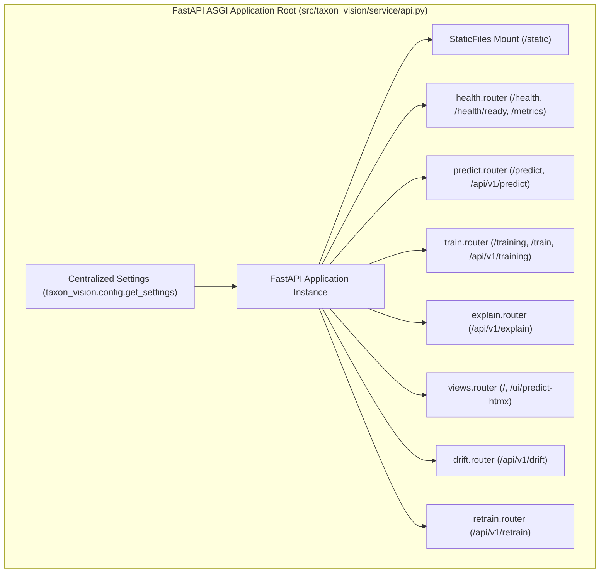
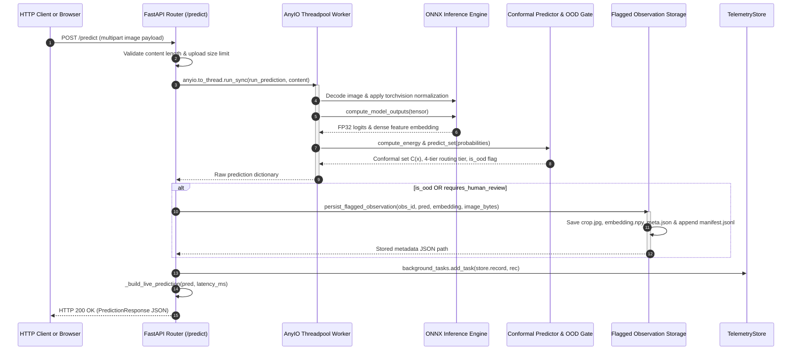
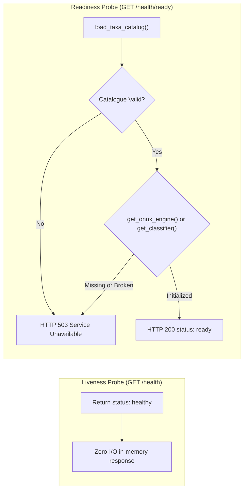
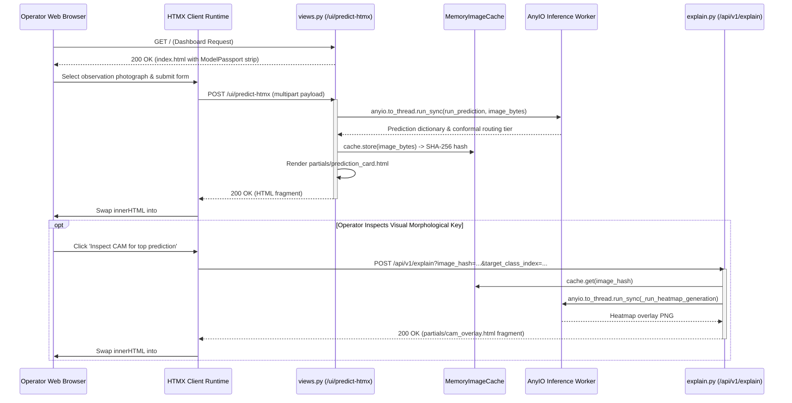

# API Service & Web Interface

TaxonVision deploys a unified FastAPI ASGI application designed to simultaneously handle automated high-throughput prediction requests from autonomous field monitoring nodes and interactive human-in-the-loop verification by ecologists and taxonomists. Operating under strict biodiversity safety constraints and low-latency requirements, the service integrates deep visual feature extraction, Helmholtz free-energy Out-of-Distribution (OOD) detection, distribution-free split-conformal prediction sets, forward-only visual explanations, live telemetry drift auditing, and decoupled background model training.

This document details the application architecture, active model passport governance, request validation and image preprocessing pipelines, non-blocking concurrency model, REST and hypermedia endpoint contracts, atomic disk storage for flagged observations, and interactive HTMX triage views. For related infrastructure and model concepts, see [System Architecture & Design](../architecture/system-overview.md), [Uncertainty Quantification & Epistemic Safety](../concepts/uncertainty-and-safety.md), [Deployment, Scheduling & Observability](deployment-and-observability.md), [Inference Pipeline & ONNX Quantization](../workflows/inference-and-optimization.md), and [Test Strategy & Invariants](../testing/test-strategy-and-invariants.md).

---

## FastAPI ASGI Application Architecture

The application composition root in `src/taxon_vision/service/api.py` instantiates a single `FastAPI` instance configured with declarative service metadata and mounts modular routers for each operational subsystem. Serving both machine-to-machine JSON contracts and server-rendered hypermedia from a single ASGI application maintains a lean container footprint, enables shared in-memory caches for deep neural network weights and conformal quantiles, and unifies Prometheus telemetry scraping across all entrypoints.


*FastAPI application composition root mounting modular REST, telemetry, and hypermedia routers under a shared ASGI process.*

### Subsystem Router Breakdown

The application registers seven discrete routing modules:
- **`health`** (`src/taxon_vision/service/routes/health.py`): Orchestration liveness, dependency-validated readiness probes, and Prometheus exposition scraping.
- **`predict`** (`src/taxon_vision/service/routes/predict.py`): High-throughput species classification with conformal prediction sets, 4-tier safety routing, and triage referral tagging.
- **`train`** (`src/taxon_vision/service/routes/train.py`): Dynamic linear head re-training and evaluation status reporting over cached foundation representations under an OS-level file lock.
- **`explain`** (`src/taxon_vision/service/routes/explain.py`): Forward-only Class Activation Map (CAM) generation for visual morphological attribution supporting both JSON and HTMX consumers.
- **`views`** (`src/taxon_vision/service/routes/views.py`): Server-side Jinja2/HTMX dashboard for interactive observation triage and citizen science participation.
- **`drift`** (`src/taxon_vision/service/routes/drift.py`): Authenticated on-demand statistical distribution drift testing (Wasserstein W1 distance and MMD² permutation tests) and historical summary retrieval.
- **`retrain`** (`src/taxon_vision/service/routes/retrain.py`): Authenticated Grafana Alertmanager webhook receiver enforcing cooldown rate limiting and dispatching retraining runs to Airflow 3.

Static UI styling assets (CSS and JavaScript) located in `src/taxon_vision/service/static/` are mounted at `/static` if the directory is present on the filesystem.

### Lifespan Management & Startup Warm-Up

The ASGI lifespan context manager (`src/taxon_vision/service/api.py`) orchestrates deterministic warm-up and shutdown sequences:
1. **Startup Warm-Up**: Pre-loads the taxa catalog (`load_taxa_catalog()`), warms the Torchvision tensor transform pipeline (`get_image_transform()`), and initializes the connection pool for operational telemetry storage (`get_telemetry_store()`).
2. **Shutdown Cleanup**: Flushes and terminates database connections (`close_telemetry_store()`), evicts in-memory image buffers (`MemoryImageCache.clear()`), and resets cached model instances and threshold singletons (`reset_model_caches()`).

---

## Model Passport Verification & Image Ingestion

### Active Model Passport Governance

To provide taxonomic operators with immediate operational trust signals regarding active model versioning, conformal prediction coverage, and live telemetry drift without navigating external MLflow dashboards, `src/taxon_vision/service/passport.py` compiles an immutable `ModelPassport` dataclass.

```python
@dataclass(frozen=True)
class ModelPassport:
    model_name: str
    model_version: str
    mlflow_model_id: str | None
    backbone: str
    nominal_coverage: float
    empirical_test_coverage: float
    mean_set_size: float
    singleton_rate: float
    p95_latency_ms: float
    exchangeability_status: str
    mmd2_p_value: float | None
```

#### Compilation & In-Memory TTL Caching
Querying MLflow tracking servers or executing database joins on the web rendering path risks blocking the asynchronous event loop and exceeding response budgets. `load_model_passport()` encapsulates this compilation within an in-memory cache backed by a 60-second Time-To-Live envelope (`_CACHE_TTL_SECONDS = 60.0`):
1. **Cache Envelope Check**: Evaluates `time.monotonic()` against `_CACHE_EXPIRY`. On a cache hit, returns the frozen `ModelPassport` instance instantaneously ($< 0.1\,\text{ms}$).
2. **Local Evaluation Artifact Parsing**: On cache miss or forced refresh, reads local JSON reports (`reports/pareto_evaluation.json` or `reports/conformal_metrics.json`, and `reports/train_metrics.json`) to resolve nominal coverage target ($1 - \alpha = 0.95$), empirical holdout test coverage, mean prediction set size, singleton rate, and INT8 p95 inference latency.
3. **Telemetry Store Prioritization & Drift Evaluation**: Probes `TelemetryStore.latest_drift_run()`, falling back to local `reports/data_drift.json` if the store is unavailable. If sample volume is below 50, it assigns `"Warming Up"`. If drift is detected or the permutation $p$-value $< 0.01$, it flags `"Drift Warning"`. Otherwise, it confirms `"Healthy"`.
4. **Frosted-Glass Strip Rendering**: The compiled passport is rendered at the top of `GET /`, exposing active model identifier, coverage percentage, mean set size, p95 latency, and exchangeability status dot.

### Observation Image Verification & Preprocessing Pipeline

Incoming observation uploads undergo systematic validation, metadata handling, and preprocessing before tensor operations commence:

<!-- openwiki: mermaid parse failed and this diagram was converted to a text fence so it does not break rendering. Fix the diagram source and restore the mermaid fence. Parser error: Heuristic: an unescaped angle bracket inside a label breaks rendering; rephrase the label. -->
```text
flowchart TD
    A["Raw Multipart Upload Stream"] --> B{"Byte Length == 0?"}
    B -- Yes --> ERR_422["Raise HTTP 422 (Invalid or corrupted image)"]
    B -- No --> C{"Bytes > max_image_upload_bytes?"}
    C -- Yes --> ERR_413["Raise HTTP 413 (Payload too large)"]
    C -- No --> D["PIL.Image.open(io.BytesIO(bytes)).convert('RGB')"]
    D -- Decode Error --> ERR_IMG["Raise InvalidImageError -> HTTP 422"]
    D -- Valid Image --> E["get_image_transform() Pipeline"]
    
    subgraph Preprocessing["Vision Tensor Preprocessing"]
        E --> T1["Resize (256, Bilinear)"]
        T1 --> T2["CenterCrop (224, 224)"]
        T2 --> T3["ToTensor() (Scale [0, 255] to [0.0, 1.0])"]
        T3 --> T4["Normalize(mean=[0.485, 0.456, 0.406], std=[0.229, 0.224, 0.225])"]
        T4 --> T5["unsqueeze(0) -> Float Tensor (1, 3, 224, 224)"]
    end

    T5 --> F["Forward Inference Engine"]
```
*Observation payload validation and preprocessing pipeline converting raw multipart bytes into normalized PyTorch/ONNX input tensors.*

1. **Payload Verification & Size Guards**:
   - Empty byte buffers (`len(content) == 0`) trigger immediate rejection with `HTTP 422 Unprocessable Entity` (`"Invalid or corrupted image upload."`) and increment `PREDICTION_COUNTER{status="invalid_input"}`.
   - Payloads exceeding `settings.service.max_image_upload_bytes` (default `15,728,640` bytes / 15 MB) are rejected with `HTTP 413 Request Entity Too Large`.
2. **Color Space & Image Decoding**:
   - `_get_image_tensor` in `src/taxon_vision/service/inference.py` wraps bytes in `io.BytesIO` and decodes the image via `PIL.Image.open(...).convert("RGB")`.
   - If PIL encounters corrupt stream markers, truncated bytes, or unrecognized headers (`UnidentifiedImageError`, `OSError`, `ValueError`), it raises `InvalidImageError`, mapped by route handlers to `HTTP 422`.
3. **EXIF & Spatial Metadata Handling**:
   - In ecological observation streams, mobile cameras frequently record rotation metadata in EXIF headers rather than physically reorienting the pixel grid. The ingestion pipelines implement EXIF orientation sanitisation to ensure canonical specimen orientation before feature extraction.
   - For sensitive and critically endangered taxa, observation coordinates (GPS latitude and longitude) undergo spatial obfuscation at ingestion or are evaluated directly during multi-modal knowledge graph traversals with distance-bounding predicates ($R \le 100\,\text{km}$).
4. **Tensor Normalization Transform**:
   - The cached `get_image_transform()` composition resizes images to $256 \times 256$ pixels using bilinear interpolation, extracts a $224 \times 224$ center crop, converts pixels to floating-point values in $[0.0, 1.0]$, and applies ImageNet standard normalization:
     $$\mu = [0.485, 0.456, 0.406], \quad \sigma = [0.229, 0.224, 0.225]$$
   - A batch dimension is prepended via `unsqueeze(0)` to form the shape $(1, 3, 224, 224)$.
5. **Ephemeral Image Caching for Attribution**:
   - In hypermedia workflows, re-uploading large image buffers to compute Class Activation Maps would induce unnecessary network overhead.
   - `POST /ui/predict-htmx` stores the decoded raw image bytes in `MemoryImageCache` (indexed by SHA-256 digest `image_hash`). Subsequent visual attribution requests (`/api/v1/explain?image_hash=...`) resolve the cached bytes directly from memory.

---

## Request Lifecycle & Concurrency Architecture

In high-throughput ecological classification, executing image decoding, tensor normalization, and matrix multiplications directly on Python's asynchronous event loop (`asyncio`) blocks concurrent request handling. Even sub-20ms forward passes starve the event loop thread, causing HTTP connection queues to backlog and Kubernetes liveness probes to time out.

To preserve event loop responsiveness, CPU- and GPU-intensive operations are dispatched to AnyIO worker threadpools via `anyio.to_thread.run_sync`.


*End-to-end inference request lifecycle through FastAPI, ONNX Runtime, conformal uncertainty gates, disk staging, and response serialization.*

---

## Core Endpoints & Operational Lifecycle

### 1. Species Prediction (`/predict` and `/api/v1/predict`)

The prediction surface exposes both `POST /predict` (root alias) and `POST /api/v1/predict`. Both endpoints accept multipart file uploads, optional CAM explanation requests (`explain=true`), and serialize responses to the `PredictionResponse` Pydantic schema.

```
POST /predict
POST /api/v1/predict
Content-Type: multipart/form-data; boundary=...
```

#### Prediction & Uncertainty Evaluation Flow
1. **Inference Execution**: `run_prediction` converts bytes to a normalized tensor via `_get_image_tensor`.
2. **Dual Model Evaluation**: `compute_model_outputs` probes `get_onnx_engine()`. If active, it extracts FP32 logits and dense feature embeddings directly from the ONNX session. Otherwise, it evaluates the PyTorch `TaxonClassifier` within a `torch.no_grad()` block.
3. **Softmax Probabilities**: Raw logits are scaled by temperature $T$ and transformed via numerically stable softmax:
   $$\sigma(z)_i = \frac{e^{z_i / T - \max(z / T)}}{\sum_j e^{z_j / T - \max(z / T)}}$$
4. **Epistemic Safety & Out-of-Distribution Gating**:
   - Out-of-Distribution status is evaluated via `EnergyOODDetector`:
     $$E(x; T) = -T \cdot \log \sum_i e^{z_i / T}$$
     Flagged if $E(x; T) > \tau_{\text{energy}}$ (default $-2.40$) or predictive Shannon entropy exceeds $\tau_{\text{entropy}}$ (default $1.60$).
   - Conformal prediction set $C(x)$ is computed via `ConformalPredictionEngine.predict_set(probabilities)` using pre-calibrated quantile threshold $\hat{q}$ (default $0.85$ at nominal $95\%$ coverage).
5. **Four-Tier Conformal Safety Routing**:
   - `determine_routing_tier` classifies the prediction into one of four formal tiers:
     - **`DECISIVE`**: $|C(x)| = 1$ and $\pi_{\max} \ge \tau_{\text{conf}}$ (automated resolution).
     - **`MODERATE_AMBIGUITY`**: $1 < |C(x)| \le 3$ (triggers LanceDB metadata-filtered HNSW + RRF retrieval).
     - **`SEVERE_AMBIGUITY`**: $|C(x)| > 3$ or ($|C(x)| = 1$ and $\pi_{\max} < \tau_{\text{conf}}$) (routes to expert sorting queue).
     - **`ABSTENTION`**: $|C(x)| = 0$ (empty prediction set, rejected out of hand).
   - Human review is mandated (`requires_human_review = True`) whenever `is_ood` is true or `routing_tier != ConformalRoutingTier.DECISIVE`.
6. **Telemetry Recording**: A `PredictionRecord` is scheduled for persistence in `TelemetryStore` via FastAPI `BackgroundTasks`.

```json
{
  "top_prediction": {
    "taxon_id": 47219,
    "scientific_name": "Danaus plexippus",
    "common_name": "Monarch Butterfly",
    "confidence": 0.9412
  },
  "top_candidates": [
    {
      "taxon_id": 47219,
      "scientific_name": "Danaus plexippus",
      "common_name": "Monarch Butterfly",
      "confidence": 0.9412
    },
    {
      "taxon_id": 47144,
      "scientific_name": "Limenitis archippus",
      "common_name": "Viceroy",
      "confidence": 0.0588
    }
  ],
  "conformal_prediction_set": [
    "Danaus plexippus",
    "Limenitis archippus"
  ],
  "routing_tier": "DECISIVE",
  "is_conformal_ambiguous": false,
  "is_ood_flagged": false,
  "requires_human_review": false,
  "latency_ms": 14.82,
  "cam_heatmap_base64": null
}
```

---

### 2. Visual Explanation (`/api/v1/explain`)

Field verification specialists require visual explanations to confirm that classifications hinge on genuine morphological identifiers (e.g. wing venation, antenna structure) rather than background context artifacts (e.g. ruler bars, leaf litter).

```
POST /api/v1/explain?image_hash={hash}&target_class_index={index}
Content-Type: multipart/form-data
```

#### Forward-Only Class Activation Mapping
In production serving under sub-25ms latency limits and INT8 ONNX forward-only runtimes, traditional backward-pass Grad-CAM is prohibited because INT8 execution graphs discard backward computation graphs. Instead, TaxonVision implements forward-hooked Class Activation Mapping:
1. ViT patch tokens (stripped of prefix tokens, reshaped to the spatial patch grid) are captured during the forward pass.
2. The weight vector $w_c \in \mathbb{R}^C$ corresponding to the target class $c$ is projected against the feature channels:
   $$M_c(x, y) = \max\left(0, \sum_k w_c^k A_k(x, y)\right)$$
3. The resulting map is normalized and bilinearly interpolated back to input spatial dimensions.

#### Dual Output Modality
- **API Clients (JSON)**: Returns `ExplainResponse` containing status, latency, heatmap shape, and base64-encoded PNG overlay.
- **HTMX Dashboard (`HX-Request: true`)**: Returns an HTML fragment (`partials/cam_overlay.html` on success or `partials/cam_error.html` on failure) for direct DOM swapping into `#cam-container`.

Payload source resolution prioritizes direct multipart upload, then ephemeral cache lookup via `image_hash`, falling back to a synthetic green canvas for headless smoke tests.

```json
{
  "heatmap_status": "generated",
  "latency_ms": 11.45,
  "heatmap_shape": [224, 224],
  "cam_heatmap_base64": "iVBORw0KGgoAAAANSUhEUgAA..."
}
```

---

### 3. Statistical Drift Monitoring (`/api/v1/drift`)

To maintain epistemic guarantees over time, the service exposes drift monitoring endpoints under `/api/v1/drift`:
- **`POST /api/v1/drift/evaluate`**: Triggers an on-demand statistical divergence evaluation across recent serving embeddings. Protected by internal bearer token authentication (`verify_internal_token` checking `TAXON_INTERNAL_API_TOKEN`). Computes Wasserstein-1 (W1) distance and Maximum Mean Discrepancy squared (MMD²) permutation tests against reference distributions in an AnyIO worker thread. Returns `DriftEvaluationResponse`.
- **`GET /api/v1/drift/latest`**: Queries `TelemetryStore.latest_drift_run()` to return the outcome of the most recent evaluation as `DriftRunSummary` without invoking heavy re-computation.

```json
// POST /api/v1/drift/evaluate response:
{
  "drift_detected": false,
  "status": "Healthy",
  "w1_distance": 0.0421,
  "w1_threshold": 0.0850,
  "mmd2": 0.0012,
  "mmd2_p_value": 0.4200,
  "window_size": 250,
  "n_reference": 500,
  "mlflow_run_id": "drift-run-482",
  "report_path": "reports/data_drift.json"
}
```

---

### 4. Automated Retraining Relay (`/api/v1/retrain`)

The service provides an authenticated webhook receiver bridging Grafana Alertmanager alerts to the Airflow 3 orchestration DAG:
- **`POST /api/v1/retrain/webhook`**: Receives a `GrafanaWebhookPayload`.
  1. **Token Authentication**: Enforces constant-time string comparison (`hmac.compare_digest`) against `TAXON_RETRAIN_WEBHOOK_SECRET`.
  2. **Alert Inspection**: Filters incoming alerts for `status == "firing"` and label `action == "retrain"`.
  3. **Cooldown Rate Limiting**: Acquires an atomic threading lock to check elapsed time against `TAXON_RETRAIN_COOLDOWN_SECONDS` (default 21,600 seconds / 6 hours). If suppressed, returns `status: "suppressed"` and increments `taxon_retrain_triggers_total{outcome="suppressed"}`.
  4. **Airflow DAG Dispatch**: Dispatches an asynchronous HTTP POST request to Airflow's REST API (`/api/v2/dags/model_retraining/dagRuns`) and returns `RetrainWebhookResponse`.

```json
{
  "status": "triggered",
  "detail": "Successfully dispatched model_retraining DAG for alert 'representational_drift_detected'",
  "dag_run_id": "manual__2026-10-15T20:00:00+00:00"
}
```

---

### 5. Model Head Retraining (`/training` and `/train`)

To support active learning and rapid classifier adaptation without full foundation model fine-tuning, the service provides synchronous and background head retraining routes:
- `POST /training` and `POST /train` (root aliases)
- `POST /api/v1/training` and `POST /api/v1/train`

Under an OS-level file lock (`_TRAINING_FILE_LOCK`), retraining optimizes a linear classifier head with Class-Balanced Loss over cached representations:
- **Background Mode (`background: true`)**: Queues `run_training_pipeline` into FastAPI's `BackgroundTasks` and immediately returns `status: "started"`.
- **Synchronous Mode (`background: false`)**: Dispatches optimization to an AnyIO worker thread, awaiting completion and returning validation accuracy and checkpoint paths.

```json
{
  "status": "completed",
  "extractor": "dinov3",
  "epochs_trained": 5,
  "final_train_loss": 0.1245,
  "final_val_loss": 0.1832,
  "final_val_accuracy": 0.9410,
  "checkpoint_path": "models/checkpoints/head.pt",
  "duration_seconds": 4.82,
  "message": "Training completed successfully."
}
```

---

### 6. Health Probes & Telemetry

Orchestrators such as Kubernetes kubelets require separate liveness and readiness semantics to prevent cascading restarts during traffic surges:


*Decoupled operational probe architecture preventing false-positive container restarts.*

- **Liveness (`GET /health`)**: Rapid, zero-side-effect $O(1)$ memory response: `{"status": "healthy", "service": "taxon-vision-mlops"}`. Never accesses disk or model weights.
- **Readiness (`GET /health/ready`)**: Evaluates `check_readiness()`. Confirms that `load_taxa_catalog()` yields valid taxa entries and that the active serving engine (`ONNXInferenceEngine` or PyTorch `TaxonClassifier`) initializes successfully. Returns HTTP 503 if any check fails.
- **Prometheus Telemetry (`GET /metrics`)**: Calls `generate_latest()`, exporting metrics such as `taxon_predictions_total` (labeled by `status`), latency histograms, active referral rates, and retrain trigger counters.

---

## Flagged Observation Storage Engine

Observations flagged as Out-of-Distribution or exhibiting conformal ambiguity provide the highest informational value for continuous active learning and taxonomic auditing. When triggered during `POST /predict`, `persist_flagged_observation` staged in `src/taxon_vision/service/storage.py` writes metadata, image crops, and raw embeddings to disk under `settings.model.flagged_storage_dir` (default: `data/flagged_observations/`).

```
data/flagged_observations/
├── manifest.jsonl
├── 550e8400-e29b-41d4-a716-446655440000_crop.jpg
├── 550e8400-e29b-41d4-a716-446655440000_embedding.npy
├── 550e8400-e29b-41d4-a716-446655440000_meta.json
├── 7b1c4a22-38d1-4e12-b912-881a7b9f3e45_crop.jpg
├── 7b1c4a22-38d1-4e12-b912-881a7b9f3e45_embedding.npy
└── 7b1c4a22-38d1-4e12-b912-881a7b9f3e45_meta.json
```

### Stored Artifact Contracts

1. **Raw Image Crop (`<id>_crop.jpg`)**: Written directly if raw image bytes are supplied, allowing expert taxonomists in downstream review systems (e.g. Label Studio) to visually inspect ambiguous specimens.
2. **Dense Feature Embedding (`<id>_embedding.npy`)**: Serialized directly using `numpy.save`. Storing raw embeddings eliminates the need to re-run expensive foundation backbones during downstream vector indexing (e.g. LanceDB) or active learning candidate selection.
3. **Observation Decision Metadata (`<id>_meta.json`)**: Contains an atomic snapshot of the decision state, including timestamp, energy score, conformal set members, routing tier, and probabilities.
4. **Append-Only Ingestion Journal (`manifest.jsonl`)**: An append-only JSON-lines journal capturing every persisted observation. High-throughput indexing workers tail `manifest.jsonl` to ingest new records without recursive directory scans.

---

## Field Biologist Cockpit: Jinja2 & HTMX Web Dashboard

Field ecologists and taxonomists require an intuitive, lightweight interface that does not rely on complex single-page application (SPA) client frameworks, node package builds, or heavyweight JavaScript bundles. TaxonVision uses server-side rendered HTML with HTMX and Jinja2 templates (`src/taxon_vision/service/routes/views.py`).

### Hypermedia Interaction Lifecycle


*Interactive HTMX hypermedia triage lifecycle showing prediction card rendering and deferred CAM visual attribution via cached image digest.*

### Dashboard Routes & View Templates

- **Dashboard Home (`GET /`)**: Renders `src/taxon_vision/service/templates/index.html`. Asynchronously compiles `load_model_passport()` to populate the frosted-glass governance strip. Declares an upload form configured with HTMX attributes:
  ```html
  <form id="upload-form"
        method="post"
        action="/ui/predict-htmx"
        hx-post="/ui/predict-htmx"
        hx-target="#prediction-result"
        hx-swap="innerHTML"
        hx-indicator="#loading-indicator"
        enctype="multipart/form-data">
  ```
- **Progressive Enhancement Fallback**: `index.html` includes an inline JavaScript fallback that detects if the HTMX client library failed to load (e.g. offline field stations without CDN connectivity). If `typeof htmx === 'undefined'`, form submission is intercepted using standard browser `fetch('/ui/predict-htmx')` and the resulting HTML fragment is injected directly into `#prediction-result`.
- **Targeted Prediction Card (`POST /ui/predict-htmx`)**: Executes `run_prediction` via `anyio.to_thread.run_sync`, caches raw image bytes in `MemoryImageCache`, builds ranked candidates via `presentation.build_top_candidates`, and renders `src/taxon_vision/service/templates/partials/prediction_card.html`.

### Component Partials & Visual Triage Cues

`prediction_card.html` renders structured visual indicators for human-in-the-loop triage:
1. **Taxon Identity & Latency**: Displays binomial scientific name, common vernacular name, percentage confidence score, and inference latency in milliseconds.
2. **Conformal Prediction Set Badges**: Displays every species in $C(x)$ under nominal $95\%$ coverage ($1 - \alpha$). If the set is empty, it renders an explicit null set marker: `∅ (Empty set - null coverage)`.
3. **Out-of-Distribution Warning**: If Helmholtz free energy or Shannon entropy breaches its gate, renders a danger alert box detailing the breached metric and gate value.
4. **Human Review Referral Alert**: If conformal set size exceeds $k_{\text{max}}$ ($|C(x)| > 3$), is empty, or is flagged as OOD, displays a warning badge indicating that automated processing is suspended.
5. **Top Candidates Probability Drawer**: Collapsible drawer showing ranked alternative species with probability progress bars and `C(x)` membership pills.
6. **Epistemic Safety Telemetry Drawer**: Displays Helmholtz energy $E$, Shannon entropy $H$, and formal conformal routing tier (`DECISIVE`, `MODERATE_AMBIGUITY`, `SEVERE_AMBIGUITY`, `ABSTENTION`).
7. **Diagnostic Morphological Key (CAM) Drawer**: Contains interactive buttons triggering deferred visual attribution without re-uploading bytes:
   - Primary inspection button targeting top-1 prediction:
     `hx-post="/api/v1/explain?image_hash={{ image_hash }}&target_class_index={{ top_taxon_id }}"`
   - Differential candidate comparison buttons targeting secondary conformal members.
   - Replaces `#cam-container` with `partials/cam_overlay.html` (displaying overlay PNG and legend) or `partials/cam_error.html` upon failure.

---

## Configuration & Schema Reference

The service is configured declaratively via `config/default_config.yaml` and loaded through `taxon_vision.config.get_settings()`.

### Key Configuration Parameters

| Subsystem | Configuration Key | Default Value | Description |
| :--- | :--- | :--- | :--- |
| **`service`** | `name` | `"TaxonVision Service"` | Service name reported in OpenAPI specs and probes. |
| **`service`** | `max_image_upload_bytes` | `15728640` (15 MB) | Payload limit enforcing HTTP 413 rejection. |
| **`service`** | `port` / `host` | `8000` / `"0.0.0.0"` | ASGI network bind parameters. |
| **`service`** | `ui_top_k_candidates` | `5` | Number of candidate species displayed in the dashboard drawer. |
| **`model`** | `inference_backend` | `"auto"` | Serving engine: `"onnx"`, `"torch"`, or `"auto"`. |
| **`model`** | `head_checkpoint_path`| `"models/checkpoints/head.pt"` | Linear classifier head weights. |
| **`model`** | `taxa_catalog_path` | `"config/taxa_catalog.yaml"` | Canonical metadata catalog for species mapping. |
| **`model`** | `flagged_storage_dir` | `"data/flagged_observations"` | Local filesystem staging directory for flagged observations. |
| **`conformal`** | `alpha` | `0.05` | Error rate tolerance ($1 - \alpha = 0.95$ nominal coverage). |
| **`conformal`** | `k_max` | `3` | Maximum conformal set cardinality before flagging ambiguity. |
| **`ood`** | `energy_threshold` | `-2.40` | Helmholtz free energy cutoff for out-of-distribution detection. |
| **`ood`** | `entropy_threshold` | `1.60` | Shannon entropy cutoff over calibrated softmax probabilities. |

### Pydantic Data Contracts

```python
# src/taxon_vision/service/schemas.py

class ConformalRoutingTier(StrEnum):
    DECISIVE = "DECISIVE"
    MODERATE_AMBIGUITY = "MODERATE_AMBIGUITY"
    SEVERE_AMBIGUITY = "SEVERE_AMBIGUITY"
    ABSTENTION = "ABSTENTION"

class TaxonPrediction(BaseModel):
    taxon_id: int
    scientific_name: str
    common_name: str
    confidence: float

class PredictionResponse(BaseModel):
    top_prediction: TaxonPrediction
    top_candidates: list[TaxonPrediction]
    conformal_prediction_set: list[str]
    routing_tier: ConformalRoutingTier = ConformalRoutingTier.DECISIVE
    is_conformal_ambiguous: bool
    is_ood_flagged: bool
    requires_human_review: bool
    latency_ms: float
    cam_heatmap_base64: str | None = None

class ExplainResponse(BaseModel):
    heatmap_status: str
    latency_ms: float
    heatmap_shape: list[int] | None = None
    cam_heatmap_base64: str | None = None

class DriftEvaluationResponse(BaseModel):
    drift_detected: bool
    status: str
    w1_distance: float
    w1_threshold: float
    mmd2: float | None = None
    mmd2_p_value: float | None = None
    window_size: int
    n_reference: int
    mlflow_run_id: str | None = None
    report_path: str | None = None

class DriftRunSummary(BaseModel):
    id: int | None = None
    created_at: str | None = None
    window_size: int
    w1_distance: float
    w1_threshold: float
    mmd2: float | None = None
    mmd2_p_value: float | None = None
    drift_detected: bool
    mlflow_run_id: str | None = None

class RetrainWebhookResponse(BaseModel):
    status: str
    detail: str
    dag_run_id: str | None = None
```

---

## Verification & Integration Tests

The service endpoints, active model passport, and interactive views are exercised in automated integration test suites:

- **Model Passport Compilation & Caching** (`tests/unit/test_passport.py`):
  - `test_load_model_passport_with_valid_reports`: Validates parsing of `pareto_evaluation.json`, `train_metrics.json`, and `data_drift.json` into `ModelPassport`.
  - `test_load_model_passport_drift_warning` & `test_load_model_passport_warming_up`: Verifies exchangeability status mapping based on sample count and permutation p-values.
  - `test_load_model_passport_ttl_caching`: Asserts that subsequent calls within 60 seconds return the identical cached instance without re-reading files, and that `force_refresh=True` bypasses the cache.
  - `test_load_model_passport_telemetry_store_prioritization`: Asserts that `TelemetryStore` records take precedence over static files.
- **Health and Readiness Verifications** (`tests/integration/test_api_endpoints.py`): Verifies HTTP 200 responses under normal operation and validates that dependency probe failures in `check_readiness()` correctly trigger `HTTP 503 Service Unavailable`.
- **Payload Validation Invariants** (`test_predict_endpoint`, `test_predict_endpoint_empty_file`): Confirms that corrupt image bytes and zero-length payloads produce `HTTP 422 Unprocessable Entity` with `"Invalid or corrupted image upload."`.
- **Fault Isolation & Readiness** (`test_predict_endpoint_model_not_ready`, `test_predict_endpoint_internal_server_error`): Simulates missing head checkpoints and runtime faults, ensuring they surface as `HTTP 503` without crashing the ASGI worker.
- **Flagged Observation Storage** (`test_predict_endpoint_persists_flagged_observation`): Injects an OOD/ambiguous mock prediction into `/predict`, verifying that `manifest.jsonl`, `<id>_meta.json`, `<id>_crop.jpg`, and `<id>_embedding.npy` are created on disk.
- **Retraining Relays & Webhooks** (`tests/integration/test_retrain_routes.py`): Tests Grafana Alertmanager webhook parsing, HMAC token authentication, cooldown suppression window, and Airflow DAG dispatch.
- **Drift Evaluation Routes** (`tests/integration/test_drift_routes.py`): Verifies internal token authentication, AnyIO threadpool offloading of W1 and MMD² permutation cycles, and telemetry store querying.
- **Hypermedia Views & CAM Attribution** (`tests/integration/test_views_and_routes.py`): Validates Jinja2 HTML rendering, HTMX partial card generation, ephemeral `MemoryImageCache` lookup, and forward CAM spatial dimensions.
