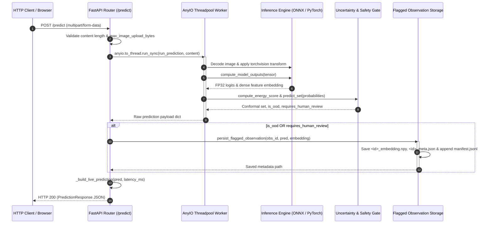
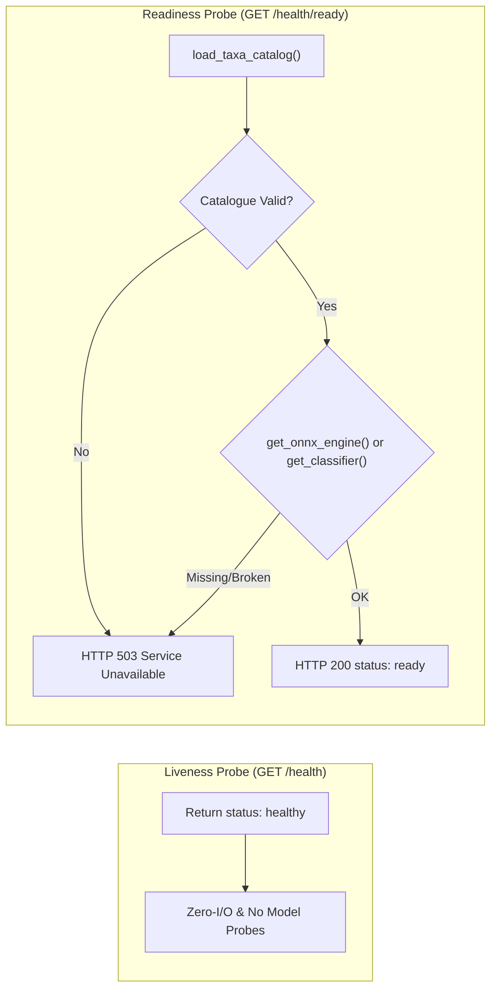
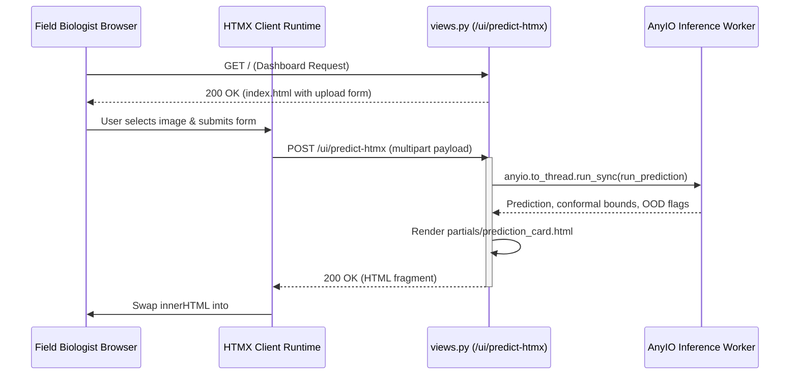

# API Service & Web Interface

TaxonVision deploys a unified FastAPI ASGI application designed to simultaneously handle automated high-throughput prediction requests from autonomous monitoring nodes and interactive human-in-the-loop verification by field biologists and taxonomists. Operating under strict biodiversity safety constraints and low-latency requirements, the service integrates deep visual feature extraction, Helmholtz free-energy Out-of-Distribution (OOD) detection, distribution-free split-conformal prediction sets, forward-only visual explanations, and decoupled background model training.

This document details the application architecture, request validation pipelines, non-blocking concurrency model, REST and hypermedia endpoint lifecycles, atomic disk storage for flagged observations, and interactive HTMX dashboard views. For related infrastructure and model concepts, see [System Architecture & Design](../architecture/system-overview.md), [Uncertainty Quantification & Epistemic Safety](../concepts/uncertainty-and-safety.md), [Deployment, Scheduling & Observability](deployment-and-observability.md), [Inference Pipeline & ONNX Quantization](../workflows/inference-and-optimization.md), and [Test Strategy & Invariants](../testing/test-strategy-and-invariants.md).

---

## FastAPI ASGI Application Architecture

The application composition root in `src/taxon_vision/service/api.py` instantiates a single `FastAPI` instance configured with declarative service metadata and mounts modular routers for each operational subsystem. Serving both machine-to-machine JSON contracts and server-rendered hypermedia from a single ASGI application maintains a lean container footprint, enables shared in-memory caches for deep neural network weights and conformal quantiles, and unifies Prometheus telemetry scraping across all entrypoints.

<!-- openwiki: mermaid parse failed and this diagram was converted to a text fence so it does not break rendering. Fix the diagram source and restore the mermaid fence. Parser error: Heuristic: an unescaped angle bracket inside a label breaks rendering; rephrase the label. -->
```text
flowchart TD
    subgraph ASGI["FastAPI ASGI Application Root (src/taxon_vision/service/api.py)"]
        CFG["Centralized Settings<br/>(taxon_vision.config.get_settings)"]
        APP["FastAPI(title, version, description)"]
        STATIC["StaticFiles Mount<br/>(/static)"]
        
        R_HLT["health.router<br/>(/health, /health/ready, /metrics)"]
        R_PRD["predict.router<br/>(/predict, /api/v1/predict)"]
        R_TRN["train.router<br/>(/training, /train, /api/v1/training)"]
        R_EXP["explain.router<br/>(/api/v1/explain)"]
        R_VIW["views.router<br/>(/, /ui/predict-htmx)"]
    end

    CFG --> APP
    APP --> STATIC
    APP --> R_HLT
    APP --> R_PRD
    APP --> R_TRN
    APP --> R_EXP
    APP --> R_VIW
```
*FastAPI application composition root mounting modular routers and static assets under a shared ASGI process.*

### Subsystem Router Breakdown

The application registers five discrete routing modules:
- **`health`** (`src/taxon_vision/service/routes/health.py`): Orchestration liveness, dependency-validated readiness probes, and Prometheus exposition scraping.
- **`predict`** (`src/taxon_vision/service/routes/predict.py`): High-throughput species classification with conformal prediction sets and triage referral tagging.
- **`train`** (`src/taxon_vision/service/routes/train.py`): Dynamic linear head re-training and evaluation status reporting over cached foundation representations.
- **`explain`** (`src/taxon_vision/service/routes/explain.py`): Forward-only Class Activation Map (CAM) generation for visual morphological attribution.
- **`views`** (`src/taxon_vision/service/routes/views.py`): Server-side Jinja2/HTMX dashboard for interactive observation triage and citizen science participation.

Static UI styling assets (CSS and JavaScript) located in `src/taxon_vision/service/static/` are mounted at `/static` if the directory is present on the filesystem.

---

## Request Lifecycle & Concurrency Architecture

In high-throughput ecological classification, running image decoding, tensor normalization, and matrix multiplications directly on Python's asynchronous event loop (`asyncio`) blocks concurrent request handling. Even sub-20ms forward passes starve the event loop thread, causing HTTP connection queues to backlog and health probes to time out. 

To preserve event loop responsiveness, CPU- and GPU-intensive operations are dispatched to AnyIO worker threadpools via `anyio.to_thread.run_sync`.


*End-to-end request lifecycle from multipart upload through threadpool dispatch, uncertainty gating, disk persistence, and schema serialization.*

---

## Core Endpoints & Operational Lifecycle

### 1. Species Prediction (`/predict` and `/api/v1/predict`)

The prediction surface exposes both `POST /predict` (top-level alias) and `POST /api/v1/predict`. Both routes accept multipart file uploads and serialize responses according to the `PredictionResponse` Pydantic schema.

```
POST /predict
POST /api/v1/predict
Content-Type: multipart/form-data; boundary=...
```

#### Request Validation & Invariants
1. **Empty Upload Check**: If the uploaded byte stream is zero bytes (`len(content) == 0`), the endpoint rejects the request with `HTTP 422 Unprocessable Entity` (`"Invalid or corrupted image upload."`) and increments `PREDICTION_COUNTER{status="invalid_input"}`.
2. **Payload Size Guard**: If `len(content)` exceeds `settings.service.max_image_upload_bytes` (default `15,728,640` bytes / 15 MB), the endpoint rejects the payload with `HTTP 413 Request Entity Too Large` and increments `PREDICTION_COUNTER{status="invalid_input"}`.
3. **Image Decoding Validation**: Within `_get_image_tensor`, the byte payload is wrapped in `io.BytesIO` and opened via `PIL.Image.open(...).convert("RGB")`. If PIL raises `UnidentifiedImageError`, `OSError`, or `ValueError`, the pipeline raises `InvalidImageError`, caught by the route handler and mapped to `HTTP 422 Unprocessable Entity`.
4. **Model Readiness Guard**: If model checkpoint weights are missing or graph definitions mismatch the catalogue, `ModelNotReadyError` is caught and translated into `HTTP 503 Service Unavailable` (`"Model inference failed."`), incrementing `PREDICTION_COUNTER{status="unavailable"}`. Any unhandled runtime fault is logged and returned as `HTTP 503` with `PREDICTION_COUNTER{status="error"}`.

#### Prediction & Response Construction Flow
1. **Inference Execution**: `run_prediction` converts bytes to a normalized $(1, 3, 224, 224)$ float tensor using the cached `get_image_transform()` composition (Resize to $256/224 \times 224 \approx 256$ Bilinear, CenterCrop to $224$, ToTensor, and Normalize).
2. **Model Evaluation**: `compute_model_outputs` probes `get_onnx_engine()`. If active, it extracts FP32 logits and dense feature embeddings directly from ONNX Runtime. Otherwise, it evaluates the PyTorch `TaxonClassifier` within a `torch.no_grad()` context.
3. **Temperature Softmax**: Raw logits are scaled by `settings.model.temperature` (default $1.0$) and transformed via numerically stable softmax:
   $$\sigma(z)_i = \frac{e^{z_i / T - \max(z / T)}}{\sum_j e^{z_j / T - \max(z / T)}}$$
4. **Epistemic Safety & Uncertainty Check**:
   - Out-of-Distribution status is evaluated via `EnergyOODDetector`:
     $$E(x; T) = -T \cdot \log \sum_i e^{z_i / T}$$
     Flagged if $E(x; T) > \tau_{\text{energy}}$ (default $-2.40$) or predictive Shannon entropy exceeds $\tau_{\text{entropy}}$ (default $1.60$).
   - Conformal prediction set $C(x)$ is computed via `ConformalPredictionEngine.predict_set(probabilities)` using pre-calibrated quantile threshold $\hat{q}$ (default $0.85$ at nominal $95\%$ coverage).
   - Human review is mandated (`requires_human_review = True`) if $C(x)$ cardinality is $0$, if $C(x)$ is ambiguous ($|C(x)| > k_{\text{max}}$, default $3$), or if flagged as OOD.
5. **Storage Trigger**: If `is_ood` or `requires_human_review` is true, an observation UUID is generated and persisted to disk along with its embedding vector.
6. **Live Schema Mapping**: `_build_live_prediction` matches predicted indices against the cached YAML taxa catalogue (`load_taxa_catalog()`), distributing remaining probability evenly across secondary conformal members:
   $$p_{\text{candidate}} = \frac{1.0 - p_{\text{top}}}{\max(1, |C(x)| - 1)}$$

```json
{
  "top_prediction": {
    "taxon_id": 47219,
    "scientific_name": "Danaus plexippus",
    "common_name": "Monarch Butterfly",
    "confidence": 0.9412
  },
  "top_candidates": [
    {
      "taxon_id": 47219,
      "scientific_name": "Danaus plexippus",
      "common_name": "Monarch Butterfly",
      "confidence": 0.9412
    },
    {
      "taxon_id": 47144,
      "scientific_name": "Limenitis archippus",
      "common_name": "Viceroy",
      "confidence": 0.0588
    }
  ],
  "conformal_prediction_set": [
    "Danaus plexippus",
    "Limenitis archippus"
  ],
  "is_conformal_ambiguous": false,
  "is_ood_flagged": false,
  "requires_human_review": false,
  "latency_ms": 14.82
}
```

---

### 2. Visual Explanation (`/api/v1/explain`)

Ecologists and field verification specialists require visual explanations to confirm that classifications hinge on morphological identifiers (e.g. wing venation, dorsal spots) rather than spurious background artifacts (e.g. ruler bars, leaf litter).

```
POST /api/v1/explain
Content-Type: multipart/form-data
```

#### Forward-Only Class Activation Mapping
In production serving under sub-25ms latency limits and INT8 ONNX forward-only runtimes, traditional backward-pass Grad-CAM is prohibited because INT8 execution graphs discard backward computation graphs. Instead, TaxonVision implements forward-hooked Class Activation Mapping:
1. Terminal spatial feature maps $A \in \mathbb{R}^{C \times H \times W}$ are captured during the forward pass.
2. The weight vector $w_c \in \mathbb{R}^C$ corresponding to the target class $c$ is projected against the feature channels:
   $$M_c(x, y) = \max\left(0, \sum_k w_c^k A_k(x, y)\right)$$
3. The resulting map is normalized and bilinearly interpolated back to the input spatial dimensions $(H, W)$.

The endpoint accepts an optional `file`. If omitted, it generates attribution against a synthetic green canvas for headless smoke testing. Execution is offloaded to AnyIO (`anyio.to_thread.run_sync(_run_heatmap_generation, content)`).

```json
{
  "heatmap_status": "generated",
  "latency_ms": 11.45,
  "heatmap_shape": [224, 224]
}
```

If image bytes cannot be decoded, `HTTP 400 Bad Request` is raised; if saliency extraction fails, `HTTP 422 Unprocessable Entity` is returned.

---

### 3. Model Head Retraining (`/training` and `/train`)

To support active learning and rapid classifier adaptation without full foundation model fine-tuning, the service provides synchronous and background head retraining routes:
- `POST /training`
- `POST /train` (alias)
- `POST /api/v1/training`
- `POST /api/v1/train` (alias)

#### Execution Modes
Callers supply a `TrainingRequest` payload specifying the backbone extractor, epoch count, batch size, learning rate, and execution mode:

| Mode | Parameter | Execution Mechanism | Response Behavior |
| :--- | :--- | :--- | :--- |
| **Background Task** | `background: true` | Dispatched to FastAPI `BackgroundTasks.add_task(run_training_pipeline, ...)` | Immediately returns `HTTP 200` with `status: "started"`, `epochs_trained: 0`, and duration `0.0`. |
| **Synchronous Threadpool** | `background: false` | Dispatched to AnyIO threadpool via `anyio.to_thread.run_sync(train_func)` | Awaits optimization without blocking the event loop; returns `HTTP 200` with `status: "completed"`, final loss, validation accuracy, and checkpoint destination. |

```json
// Example synchronous response:
{
  "status": "completed",
  "extractor": "dinov3",
  "epochs_trained": 5,
  "final_train_loss": 0.1245,
  "final_val_loss": 0.1832,
  "final_val_accuracy": 0.9410,
  "checkpoint_path": "models/checkpoints/head.pt",
  "duration_seconds": 4.82,
  "message": "Training completed successfully."
}
```

---

### 4. Health Probes & Telemetry

Orchestrators such as Kubernetes kubelets require separate liveness and readiness semantics to prevent cascading restarts during traffic surges:


*Decoupled operational probe architecture preventing false-positive container restarts.*

- **Liveness (`GET /health`)**: Rapid, zero-side-effect $O(1)$ memory response: `{"status": "healthy", "service": "taxon-vision-mlops"}`. Never accesses disk or model weights, preventing false-positive pod eviction under CPU load.
- **Readiness (`GET /health/ready`)**: Evaluates `check_readiness()`. Confirms that `load_taxa_catalog()` yields valid taxa entries and that the active serving engine (`ONNXInferenceEngine` or PyTorch `TaxonClassifier`) initializes successfully. If any check fails, returns `HTTP 503 Service Unavailable` with `detail: "Service not ready"`.
- **Prometheus Telemetry (`GET /metrics`)**: Calls Prometheus client registry `generate_latest()`, exporting metrics such as `taxon_predictions_total` (labeled by `status="success" | "invalid_input" | "unavailable" | "error"`), latency histograms, and active referral gauges.

---

## Flagged Observation Storage Engine

Observations flagged as Out-of-Distribution or exhibiting conformal ambiguity provide the highest informational value for continuous active learning and taxonomic auditing. When triggered during `POST /predict`, `persist_flagged_observation` staged in `src/taxon_vision/service/storage.py` writes metadata and raw embedding representations to disk.

### On-Disk Directory Layout

Files are staged under `settings.model.flagged_storage_dir` (default: `data/flagged_observations/`):

```
data/flagged_observations/
├── manifest.jsonl
├── 550e8400-e29b-41d4-a716-446655440000_meta.json
├── 550e8400-e29b-41d4-a716-446655440000_embedding.npy
├── 7b1c4a22-38d1-4e12-b912-881a7b9f3e45_meta.json
└── 7b1c4a22-38d1-4e12-b912-881a7b9f3e45_embedding.npy
```

### Stored Artifact Contracts

1. **Feature Embedding Vector (`<observation_id>_embedding.npy`)**: If the inference forward pass extracted a dense feature vector (e.g. 384-d or 768-d float32 array), it is saved directly using `numpy.save`. Storing raw embeddings eliminates the need to re-run expensive foundation model backbones during downstream vector indexing (e.g. LanceDB) or active learning candidate selection.
2. **Observation Metadata Artifact (`<observation_id>_meta.json`)**: Contains an atomic snapshot of the decision state:
   ```json
   {
     "observation_id": "550e8400-e29b-41d4-a716-446655440000",
     "timestamp_utc": "2026-10-15T19:50:00.123456+00:00",
     "ood_energy_score": -1.82,
     "is_ood": true,
     "requires_human_review": true,
     "conformal_set": [
       "Danaus plexippus",
       "Limenitis archippus",
       "Papilio glaucus",
       "Battus philenor"
     ],
     "top_prediction": {
       "scientific_name": "Danaus plexippus",
       "common_name": "Monarch Butterfly",
       "confidence": 0.4215
     },
     "probabilities": [0.4215, 0.2810, 0.1502, ...],
     "embedding_path": "550e8400-e29b-41d4-a716-446655440000_embedding.npy"
   }
   ```
3. **Streaming Ingestion Journal (`manifest.jsonl`)**: An append-only JSON-lines journal capturing every persisted observation. High-throughput indexing workers tail `manifest.jsonl` to ingest new records into object storage (MinIO) or message brokers without performing recursive directory scans.

---

## Field Biologist Cockpit: Jinja2 & HTMX Web Dashboard

Field ecologists and taxonomists require an intuitive, lightweight interface that does not rely on complex single-page application (SPA) client frameworks, node package builds, or heavyweight JavaScript bundles. TaxonVision uses server-side rendered HTML with HTMX and Jinja2 templates (`src/taxon_vision/service/routes/views.py`).

### Hypermedia Interaction Pattern


*Hypermedia lifecycle: form submission triggers targeted DOM replacement without full-page reloads.*

### Dashboard Routes & View Templates

- **Dashboard Home (`GET /`)**: Renders `src/taxon_vision/service/templates/index.html` extending `base.html`. Declares an upload form configured with HTMX attributes:
  ```html
  <form id="upload-form"
        method="post"
        action="/ui/predict-htmx"
        hx-post="/ui/predict-htmx"
        hx-target="#prediction-result"
        hx-swap="innerHTML"
        hx-indicator="#loading-indicator"
        enctype="multipart/form-data">
    <div class="dropzone" id="dropzone">
      <input type="file" id="file" name="file" accept="image/*" required>
      <label for="file" id="file-label">Drop observation photograph here or click to browse</label>
      <div id="file-preview" class="file-preview" style="display: none;">
        <span id="file-name"></span>
      </div>
    </div>
    <button type="submit" id="submit-btn" class="btn primary">Classify Observation</button>
  </form>
  ```
- **Progressive Enhancement Fallback**: `index.html` includes an inline JavaScript fallback that detects if the `htmx` client library failed to load (e.g. offline field stations without CDN connectivity). If `typeof htmx === 'undefined'`, form submission is intercepted using standard browser `fetch('/ui/predict-htmx')` and the resulting HTML fragment is injected directly into `#prediction-result`.
- **Targeted Partial Card (`POST /ui/predict-htmx`)**: Executes `run_prediction` via `anyio.to_thread.run_sync`, attempts forward-only CAM generation, and renders `src/taxon_vision/service/templates/partials/prediction_card.html`.

### Visual Triage Cues in `prediction_card.html`

The returned HTML card presents visual indicators for field decision-making:
1. **Taxon Identity & Metrics**: Displays binomial scientific name, common name, percentage confidence, and inference latency in milliseconds.
2. **Conformal Prediction Set Badges**: Renders the complete prediction set under nominal $95\%$ coverage ($1 - \alpha$). If the conformal engine yields an empty set ($|C(x)| = 0$), it displays an explicit null set marker: `∅ (Empty set - null coverage)`.
3. **Out-of-Distribution Warning**: If Helmholtz free energy exceeds the OOD threshold, renders a critical alert box:
   ```html
   <div class="alert danger">
     🛑 Out-Of-Distribution (OOD) Observation Detected (Helmholtz free energy exceeded threshold). Epistemic confidence compromised.
   </div>
   ```
4. **Human Review Referral Alert**: If conformal set size exceeds $k_{\text{max}}$ ($|C(x)| > 3$), is empty, or is flagged as OOD, displays a warning badge indicating that automated processing is suspended:
   ```html
   <div class="alert warning">
     ⚠️ High ambiguity or out-of-distribution signal. Flagged for expert taxonomist triage.
   </div>
   ```
5. **Attribution Indicator**: If visual saliency generation is unsupported or fails on the active backbone, displays an informational notice: `Visual attribution (saliency heatmap) is unavailable for this backbone architecture.`

---

## Configuration & Schema Reference

The service is configured declaratively via `config/default_config.yaml` and loaded through `taxon_vision.config.get_settings()`.

### Key Configuration Parameters

| Subsystem | Configuration Key | Default Value | Description |
| :--- | :--- | :--- | :--- |
| **`service`** | `name` | `"TaxonVision Service"` | Service name reported in OpenAPI specs and probes. |
| **`service`** | `max_image_upload_bytes` | `15728640` (15 MB) | Payload limit enforcing HTTP 413 rejection. |
| **`service`** | `port` / `host` | `8000` / `"0.0.0.0"` | ASGI network bind parameters. |
| **`model`** | `inference_backend` | `"auto"` | Serving engine: `"onnx"`, `"torch"`, or `"auto"` (ONNX if checkpoint exists). |
| **`model`** | `head_checkpoint_path`| `"models/checkpoints/head.pt"` | Linear classifier head weights. |
| **`model`** | `taxa_catalog_path` | `"config/taxa_catalog.yaml"` | Canonical metadata catalog for species mapping. |
| **`model`** | `flagged_storage_dir` | `"data/flagged_observations"` | Local filesystem staging directory for flagged observations. |
| **`conformal`** | `alpha` | `0.05` | Error rate tolerance ($1 - \alpha = 0.95$ nominal coverage). |
| **`conformal`** | `k_max` | `3` | Maximum conformal set cardinality before flagging ambiguity. |
| **`ood`** | `energy_threshold` | `-2.40` | Helmholtz free energy cutoff for out-of-distribution detection. |
| **`ood`** | `entropy_threshold` | `1.60` | Shannon entropy cutoff over calibrated softmax probabilities. |

### Pydantic Data Contracts

```python
# src/taxon_vision/service/schemas.py

class TaxonPrediction(BaseModel):
    taxon_id: int
    scientific_name: str
    common_name: str
    confidence: float

class PredictionResponse(BaseModel):
    top_prediction: TaxonPrediction
    top_candidates: list[TaxonPrediction]
    conformal_prediction_set: list[str]
    is_conformal_ambiguous: bool
    is_ood_flagged: bool
    requires_human_review: bool
    latency_ms: float

class TrainingRequest(BaseModel):
    extractor: str | None = None
    epochs: int | None = None
    batch_size: int | None = None
    learning_rate: float | None = None
    background: bool = False

class TrainingResponse(BaseModel):
    status: str
    extractor: str
    epochs_trained: int
    final_train_loss: float | None = None
    final_val_loss: float | None = None
    final_val_accuracy: float | None = None
    checkpoint_path: str
    duration_seconds: float
    message: str
```

---

## Verification & Integration Tests

The service endpoints and interactive views are exercised in automated integration test suites using FastAPI's `TestClient` (`tests/integration/test_api_endpoints.py` and `tests/integration/test_views_and_routes.py`):

- **Health and Readiness Verifications** (`test_health_endpoint`, `test_health_ready_endpoint`, `test_health_ready_failure_when_model_fails`): Verifies HTTP 200 responses under normal operation and validates that dependency probe failures in `check_readiness()` correctly trigger `HTTP 503 Service Unavailable`.
- **Payload Validation Invariants** (`test_predict_endpoint`, `test_predict_endpoint_empty_file`): Confirms that corrupt image bytes and zero-length payloads produce `HTTP 422 Unprocessable Entity` with `"Invalid or corrupted image upload."`.
- **Fault Isolation & Readiness** (`test_predict_endpoint_model_not_ready`, `test_predict_endpoint_internal_server_error`): Simulates missing head checkpoints and runtime faults, ensuring they surface as `HTTP 503` without crashing the ASGI worker.
- **Flagged Observation Storage** (`test_predict_endpoint_persists_flagged_observation`): Injects an OOD/ambiguous mock prediction into `/predict`, verifying that `manifest.jsonl`, `<id>_meta.json`, and `<id>_embedding.npy` are created on disk with valid entries.
- **Retraining Modes** (`test_training_endpoint_sync`, `test_train_alias_endpoint`, `test_training_endpoint_background`): Exercises synchronous head training returning validation metrics alongside asynchronous queueing returning `status="started"`.
- **Hypermedia Views & CAM Attribution** (`test_index_view`, `test_predict_htmx_view`, `test_explain_endpoint`, `test_explain_endpoint_with_image`): Validates Jinja2 HTML rendering, HTMX partial card generation, and forward CAM spatial dimensions.
