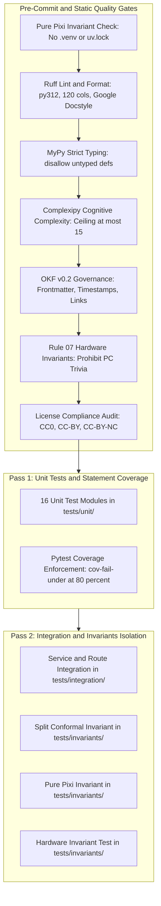
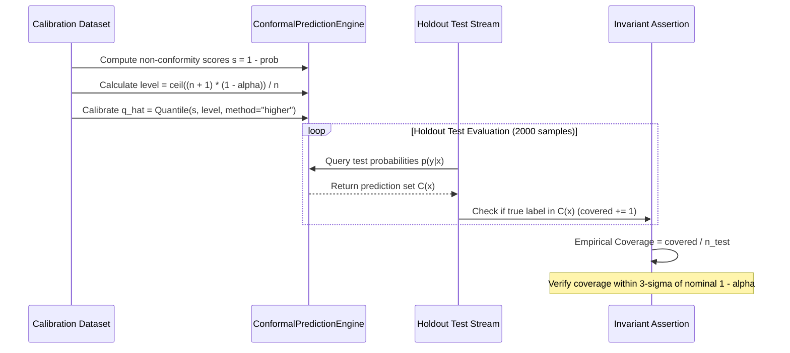
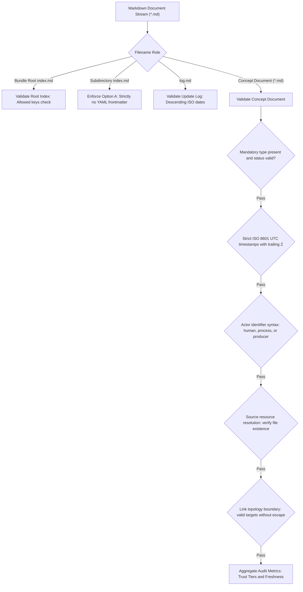

# Testing Strategy & Quality Invariants

Operating an automated species identification platform on long-tailed biological distributions requires formal guarantees of correctness, isolation, and safety. In deep vision systems trained on citizen-science data, conventional heuristic testing—such as evaluating raw top-1 accuracy on static test splits—fails to detect critical operational vulnerabilities. Heuristically confident deep classifiers frequently emit extreme probability estimates on uncalibrated or out-of-distribution inputs, while complex multi-repository dependency stacks risk silent environmental drift between development workstations and continuous integration runners.

To ensure production-grade reliability, TaxonVision enforces a rigorous verification architecture that combines a **three-tier testing pyramid**, automated **mathematical coverage invariant proofs**, a **pure Pixi workspace isolation invariant**, automated **Google Open Knowledge Format (OKF v0.2) validation**, **hardware specification governance (Rule 07)**, **Abstract Syntax Tree (AST) code invariants**, and strict **pre-commit quality gates**.

For related architectural and operational context, see [System Architecture & Design](../architecture/system-overview.md), [Domain Entities & Taxonomy Perimeter](../architecture/domain-and-taxa.md), [Uncertainty Quantification & Epistemic Safety](../concepts/uncertainty-and-safety.md), [API Service & Web Interface](../operations/service-and-api.md), [Deployment, Scheduling & Observability](../operations/deployment-and-observability.md), and [Quickstart](../quickstart.md).

---

## Testing Pyramid & Execution Model

The TaxonVision test suite is partitioned into three distinct tiers: fast, isolated **Unit Tests**; service-level **Integration Tests**; and architectural/scientific **Invariant Tests**. These suites are executed across a multi-tier continuous integration strategy designed to separate fast unit coverage regression testing from integration and invariant validation.


Continuous integration verification flow across static pre-commit gates, Pass 1 unit coverage, and Pass 2 integration and invariant assertions.

### Multi-Tier CI/CD Execution Strategy

TaxonVision maintains test execution parity across developer workstations, GitHub Actions pull request gates, and bare-metal Kubernetes Jenkins pipelines:

1. **Local CI Runner (`scripts/ci/local_ci.sh`)**
   Executes continuous integration passes on the native host interpreter without container overhead. It provides target recipes for `quality`, `tests`, `docs`, and `all`, supporting `TAXON_SKIP_SYNC=1` to bypass environment synchronization during rapid local iteration.

2. **GitHub Actions Workflow (`.github/workflows/ci.yml`)**
   Orchestrates cloud pull-request validation:
   - **`quality-gate` Job:** Configures Pixi with CPU-only environment `ci-dev`, fetches cached model checkpoints from DagsHub DVC, executes pre-commit quality checks, validates OKF v0.2 documentation, renders knowledge graph visualizations, and runs the two-pass pytest suite.
   - **`cognitive-complexity` Job:** Runs `complexipy src/` to enforce cognitive complexity budgets and exports SARIF reports to GitHub Code Scanning via `github/codeql-action/upload-sarif@v4`.
   - **`architectural-profiling` Job:** Profiles module topology and line count metrics.

3. **Enterprise Jenkins Pipeline (`Jenkinsfile`)**
   Orchestrates scheduled pipeline runs and automated model retraining on a bare-metal Kubernetes cluster (`k3s` cloud):
   - **Agent Pod:** Deploys an ephemeral agent running `ghcr.io/prefix-dev/pixi:latest` in container `ml-runner`, mounting persistent host caches for Rattler package archives (`/var/lib/taxon-vision/rattler-cache`), manifests, and checkpoints.
   - **Trigger Model:** Executes automatically at 02:00 UTC on the 1st of every month via cron (`0 2 1 * *`), with manual parameterized dispatches (`RETRAIN_MODEL`, `TUNE_HYPERPARAMETERS`, `INGEST_DATA`, `EXTRACTOR`).
   - **Parallel Quality Stage:** Executes linting, strict MyPy type checking, open license auditing, and OKF validation in parallel steps.
   - **Two-Pass Test Execution:** Runs unit tests with coverage, followed by integration and conformal invariant validation enforcing `--cov-fail-under=80`.
   - **GPU Training Stage:** When ingestion or retraining flags are set, provisions GPU resources to run DVC feature extraction, model retraining, calibration, and ONNX dynamic quantization.

### Two-Pass Execution Strategy

Test execution separates statement coverage measurement from invariant execution:

1. **Pass 1: Unit Tests & Code Coverage Enforcement**
   ```bash
   pixi run --frozen -e dev pytest tests/ --cov=src/taxon_vision --cov-fail-under=80
   ```
   Pass 1 executes unit test modules while tracking statement coverage across `src/taxon_vision`. Pytest is configured in `pyproject.toml` to fail the build if statement coverage falls below 80%, generating terminal, HTML, and XML coverage reports (`coverage.xml`).

2. **Pass 2: Integration & Invariants Isolation**
   ```bash
   pixi run --frozen -e dev pytest tests/integration/ tests/invariants/ -x -q -o "addopts="
   ```
   Pass 2 executes integration endpoints and mathematical/architectural invariants in fail-fast mode (`-x`) with minimal verbosity (`-q`). Overriding `addopts=` disables coverage instrumentation, preventing profiling overhead from distorting invariant assertions or HTTP benchmark timings.

---

## Invariant Testing Architecture

TaxonVision maintains four core invariant suites that enforce non-negotiable scientific, architectural, and governance rules.

### 1. Mathematical Invariant: Split Conformal Empirical Coverage

Standard deep neural networks emit uncalibrated softmax confidence scores that cannot be trusted for autonomous biological classification. TaxonVision rejects heuristic cutoffs in favor of **Split Conformal Prediction** (Angelopoulos & Bates, 2021), proving finite-sample marginal coverage guarantees mathematically.

#### Theoretical Foundation

Under the assumption that calibration samples and future query observations are exchangeable (independent and identically distributed), split conformal prediction constructs a prediction set $C(X) \subset \{1, \dots, K\}$ satisfying:

$$P(Y \in C(X)) \ge 1 - \alpha$$

where $\alpha \in (0, 1)$ is the nominal error budget (e.g., $\alpha = 0.05$ guarantees 95% nominal marginal coverage), $Y$ is the ground-truth taxon label, and $C(X)$ is the admitted conformal prediction set.

The non-conformity score function $s_i$ evaluates disagreement between predictive probability $p(y = i \mid x)$ and candidate class $i$:

$$s_i = 1.0 - p(y = i \mid x)$$

Given a calibration set $\mathcal{D}_{\text{cal}} = \{(x_j, y_j)\}_{j=1}^n$ of size $n$, empirical non-conformity scores are computed for each ground-truth label: $s_j = 1.0 - p(y_j \mid x_j)$. The conformal quantile threshold $\hat{q}$ is calibrated at empirical order-statistic level $l$:

$$l = \frac{\lceil(n + 1)(1 - \alpha)\rceil}{n}$$

$$\hat{q} = \text{Quantile}\left(\{s_1, \dots, s_n\}, l, \text{method} = \text{"higher"}\right)$$

Candidate taxon $i$ is admitted into $C(x)$ if its non-conformity score does not exceed $\hat{q}$ (equivalently, $p(y = i \mid x) \ge 1.0 - \hat{q}$):

$$C(x) = \{ i \in \{1, \dots, K\} \mid s_i \le \hat{q} \}$$


Conformal calibration and finite-sample empirical coverage verification sequence.

#### Invariant Implementation

The mathematical invariant is verified in `tests/invariants/test_conformal_coverage_invariant.py`:
- `test_empirical_conformal_coverage()`: Draws $n_{\text{cal}} = 2000$ calibration samples and $n_{\text{test}} = 2000$ test evaluation samples from Dirichlet distributions over 5 classes. It computes quantile level $l = \frac{\lceil(2000 + 1) \times 0.95\rceil}{2000}$ using `np.quantile(..., method="higher")` to calibrate $\hat{q}$. Across the 2000 test observations, prediction sets $C(x)$ are generated using `ConformalPredictionEngine(q_hat=q_hat, alpha=0.05, k_max=5)` and evaluated for true label inclusion. The invariant asserts that empirical coverage satisfies nominal coverage within a 3-sigma binomial error bound:
  $$\text{empirical\_coverage} \ge 1 - \alpha - 0.02$$
- `test_conformal_prediction_discrete_split_evaluation()`: Verifies that `ConformalPredictionEngine` operates cleanly across discrete 4-way `EmbeddingSplit` structures (`cal_embeddings`, `test_embeddings`, `val_embeddings`, `train_embeddings`) without data leakage.

#### Epistemic Referral & 4-Tier Routing

In `src/taxon_vision/uncertainty/conformal.py`, `predict_set` pairs set construction with active learning triage gating. Human review (`requires_human_review = True`) is mandated whenever any of three conditions is met:
1. **Empty Set ($|C(x)| = 0$):** No candidate taxon meets the probability cutoff $1 - \hat{q}$, indicating extreme model doubt or out-of-distribution morphology.
2. **Ambiguous Set ($|C(x)| > k_{\text{max}}$):** The candidate set contains more taxa than the maximum cardinality threshold (default $k_{\text{max}} = 3$ or $5$), signaling morphological ambiguity between sister taxa.
3. **Low-Confidence Singleton ($p_{\text{max}} < \text{min\_confidence\_threshold}$):** Although a single taxon passed the conformal threshold, top-1 probability fails to exceed the confidence floor ($\text{min\_confidence\_threshold} = 0.60$).

Unit tests in `tests/unit/test_conformal_bounds.py` also verify the 4-tier conformal routing contract:
- `DECISIVE`: $|C(x)| = 1$ and $p_{\text{max}} \ge \tau_{\text{conf}}$.
- `MODERATE_AMBIGUITY`: $1 < |C(x)| \le 3$.
- `SEVERE_AMBIGUITY`: $|C(x)| > 3$ or ($|C(x)| = 1$ and $p_{\text{max}} < \tau_{\text{conf}}$).
- `ABSTENTION`: $|C(x)| = 0$.

Calibration pipeline `src/taxon_vision/pipelines/calibrate.py` (invoked via `just calibrate`) filters out-of-distribution calibration embeddings using Helmholtz free energy thresholds before computing $\hat{q}$, preserving exchangeability and serializing parameters to `config/conformal_config.yaml`.

---

### 2. Pure Pixi Workspace Invariants

To eliminate environment drift and conflicting package managers (`pip`, `venv`, `uv`, `conda`), TaxonVision enforces a **pure Pixi workspace invariant**. All runtimes, system dependencies, Python interpreters, and PyPI packages are managed exclusively through Pixi (`.pixi/`).

In `tests/invariants/test_pure_pixi_invariant.py`, four automated tests verify repository hermeticity:
1. **Absence of Virtualenvs and uv Artifacts (`test_no_virtualenv_or_uv_artifacts`):** Asserts that neither `.venv/` nor `uv.lock` exists in the workspace root.
2. **Lockfile and Manifest Configuration (`test_pixi_lock_and_manifest_exist`):** Asserts that `pixi.lock` and `pyproject.toml` exist, verifying explicit environment declarations (`default`, `dev`, `ci`, `ci-dev`).
3. **VSCode Interpreter Routing (`test_vscode_interpreter_and_venv_routing`):** Parses `.vscode/settings.json` to verify that IDE tooling routes strictly to `.pixi/envs/dev/bin/python`, disables environment creation triggers (`python.createEnvironment.trigger = "off"`), and sets `pixi.environment = "dev"`.
4. **No uv Invocations in Pre-Commit Hooks (`test_no_uv_in_active_pre_commit_hooks`):** Asserts that `.pre-commit-config.yaml` contains no active hooks calling `uv run` or `uvx`.

This invariant is also guarded by the pre-commit hook `check-pure-pixi` and CI script assertions in `scripts/ci/local_ci.sh`.

---

### 3. Hardware Specification Governance (Rule 07)

TaxonVision maintains strict governance over hardware documentation to avoid unscientific consumer hardware trivia and ungrounded claims:
- **Governance Rule:** `.agents/rules/07-hardware-invariants.md` mandates that all technical documentation, LaTeX papers, and TikZ architectural diagrams state functional CPU, GPU, memory, and storage specifications cleanly without consumer branding.
- **Prohibited Patterns:** Motherboard models (e.g., ASRock, B760M), GPU board partner sub-vendors (e.g., ZOTAC), SSD consumer brands and controller chips (e.g., FireCuda, Phison, PS5018), consumer endurance metrics (TBW), RAM slot topologies (slots A2/B2), and unscientific claims regarding public cloud volatility or hypervisor jitter. Bare-metal deployments must be framed strictly around Total Cost of Ownership (TCO), zero-egress data transfer, and kernel-level resource sovereignty.
- **Verification Script (`scripts/governance/verify_hardware_invariants.py`):** Scans Markdown files, LaTeX documents, and TikZ sources against regular expression violation rules.
- **Automated Invariant Test (`tests/invariants/test_hardware_invariants.py`):**
  - `test_rule_07_hardware_invariants_pass`: Runs `verify_hardware_invariants.py` against the workspace root and asserts return code 0.
  - `test_rule_07_governance_file_exists_and_registered`: Asserts that Rule 07 exists at `.agents/rules/07-hardware-invariants.md` and is registered in `.agents/AGENTS.md`.

---

### 4. AST Code Invariants Engine

To programmatically enforce architectural hygiene and clean-code principles, TaxonVision implements an Abstract Syntax Tree (AST) static analysis engine in `scripts/governance/verify_code_invariants.py`:
- **Dynamic Reflection Prohibition (Rule 00):** Traverses the AST of all Python source modules to detect and ban calls to `hasattr()` and `getattr()`, requiring explicit typed models or protocols.
- **Function Arity Limit (Rule 08):** Detects functions accepting more than 4 positional parameters (excluding `self` and `cls`), mandating encapsulation into typed Pydantic models or dataclasses.
- **Eager Submodule Import Prohibition (Rule 00):** Inspects package `__init__.py` files to prevent eager dotted submodule imports that cause circular dependencies and slow startup times.
- **Ratcheting Mechanism:** Validates findings against a baseline snapshot (`code_invariants_baseline.json`), permitting legacy debt to be ratcheted downward without allowing new violations.
- **Invocation:** Executed via `just check-invariants` and the attestation seal runner.

---

## Google Open Knowledge Format (OKF v0.2) Validation Engine

Architectural knowledge, operational concepts, and agent run records are managed as machine-verifiable assets conforming to **Google's Open Knowledge Format (OKF v0.2)**. The validation engine in `scripts/governance/validate_okf.py` audits Markdown documentation files across `docs/`, `.agents/`, and `openwiki/`.


OKF v0.2 validation engine document categorization and frontmatter verification pipeline.

### Document Roles and Structural Invariants

The validator enforces distinct invariants based on file role:
1. **Bundle Root `index.md`:** May contain YAML frontmatter declaring `okf_version` alongside standard concept metadata (`title`, `description`, `tags`, `generated`, `verified`). Unrecognized keys trigger validation errors.
2. **Subdirectory `index.md` (Option A):** Strictly prohibited from containing YAML frontmatter (§8 Option A). Navigation prose must exist directly in the Markdown body, beginning with a section heading (`# ...`).
3. **Update Logs (`log.md`):** Strictly prohibited from containing YAML frontmatter (§9). Must contain chronological entries headed by ISO-8601 dates (`## YYYY-MM-DD`). The validator enforces strict descending chronological order (newest entries first), failing if an older date appears ahead of a newer date.
4. **Attested Computation Concepts:** Documents declaring `type: Attested Computation` must declare a mandatory `runtime` field specifying the execution environment (§10.2).

### Frontmatter Schema & Provenance Validation

Concept documents must satisfy rigorous schema constraints:
- **Mandatory `type` and Lifecycle `status`:** Every concept file must declare `type`. If declared, `status` must be one of `draft`, `stable`, or `deprecated`.
- **Strict ISO-8601 UTC Timestamps:** All dates in `stale_after`, `generated.at`, and `verified[].at` must match `^\d{4}-\d{2}-\d{2}T\d{2}:\d{2}:\d{2}(?:\.\d+)?Z$`. Date-only formats (`YYYY-MM-DD`) are rejected. The script provides an automated CLI fixer (`--fix`) that normalizes legacy date strings to strict UTC (`...T00:00:00Z`).
- **Actor Naming Conventions:** The `by` fields in `generated` and `verified` blocks must conform to `human:<id>`, `process:<id>`, or `<producer>/<version>` (matching `ACTOR_PATTERN`).
- **Trust Tier Accounting:** Provenance entries are categorized into three trust tiers (§5.3):
  - **Human-Reviewed:** Any entry where `by` begins with `human:`.
  - **Machine-Confirmed:** Verified entries created by automated tooling or pipelines.
  - **Unverified:** Documents lacking verification entries.
- **Freshness Auditing:** Compares `stale_after` against current UTC time:
  - **Fresh:** Current datetime is prior to `stale_after`.
  - **Stale:** Current datetime has exceeded `stale_after`.
  - **No Expiry Declared:** `stale_after` is omitted.

### Source Resource & Cross-Document Link Topology

The validation engine guarantees epistemic integrity across documentation references:
- **Source Resource Resolution:** For every entry in `sources`, `_resolve_source_path` verifies that the underlying file exists relative to the document parent, the workspace root, `docs/`, or `openwiki/`. Web URLs (`http://`, `https://`) and `mailto:` links are recognized and bypassed.
- **Link Topology Boundaries:** Uses regex `MARKDOWN_LINK_PATTERN` to inspect cross-document Markdown links (`[text](target.md)`). The validator confirms that the target exists and does not escape authorized knowledge bundle domains (`docs/`, `.agents/`, and `openwiki/`).

### Attested Computation Seal Runner (`.agents/verifiers/attest_seal.py`)

TaxonVision integrates a cryptographic attestation engine that executes repository verification gates in sequence:
1. Ruff Linter (`ruff check .`)
2. MyPy Strict Types (`mypy src scripts`)
3. Complexipy Invariants (`complexipy src scripts --max-complexity-allowed 15 --check-script --no-ignore`)
4. OKF v0.2 Governance (`python scripts/governance/validate_okf.py`)
5. Rule 07 Hardware Invariants (`python scripts/governance/verify_hardware_invariants.py`)
6. Open License Compliance (`python -m taxon_vision.pipelines.audit_license`)
7. AST Code Invariants (`python scripts/governance/verify_code_invariants.py`)
8. Fast Targeted Test Suite (`pytest tests/unit/test_config.py ...`)

Upon completion, `attest_seal.py` generates an Attested Computation document (`attested_computation.md`) recording `runtime: "Pixi linux-64 dev"`, timestamp, git commit SHA-256 hash, and gate outcome summary, writes a JSON receipt (`.agents/receipts/receipt_<timestamp>.json`), and updates `.agents/log.md` in descending chronological order.

---

## Detailed Test Suite Organization

The `tests/` directory is structured into three specialized domains, containing 21 test modules and a shared fixtures harness:

```
tests/
├── conftest.py                              # Shared environment isolation & fixtures
├── invariants/                              # Scientific and architectural non-regression proofs (3 modules)
│   ├── test_conformal_coverage_invariant.py # Finite-sample coverage P(Y in C(X)) >= 1 - alpha
│   ├── test_hardware_invariants.py          # Rule 07 hardware representation invariants
│   └── test_pure_pixi_invariant.py          # Pure Pixi isolation and VSCode routing
├── integration/                             # End-to-end service, API, and UI integration tests (2 modules)
│   ├── test_api_endpoints.py                # REST API contracts, 422 errors, 503 readiness, training
│   └── test_views_and_routes.py             # Jinja2/HTMX dashboard, CAM heatmaps, Prometheus telemetry
└── unit/                                    # Isolated functional unit tests (16 modules)
    ├── test_active_learning.py              # Margin sampling and priority triage queue
    ├── test_class_balanced_loss.py          # Effective number of samples re-weighting
    ├── test_cli_and_training.py             # CLI argument dispatch and training runners
    ├── test_config.py                       # Pydantic-settings loading and custom YAML overrides
    ├── test_conformal_bounds.py             # Set cardinality boundaries and triage conditions
    ├── test_data_components.py              # S3 streaming, Parquet ingestion, and API client
    ├── test_license_filter.py               # Open license whitelisting (CC0, CC-BY, CC-BY-NC)
    ├── test_models_components.py            # Feature extractors, classifier heads, and evaluation
    ├── test_monitoring.py                   # Wasserstein-1 embedding drift distance
    ├── test_onnx_exporter.py                # Computational graph export, dual outputs, failure semantics
    ├── test_ood_energy.py                   # Helmholtz free energy and predictive entropy
    ├── test_pipelines.py                    # Feature extraction configs and stratified splits
    ├── test_quantizer.py                    # Dynamic INT8 ONNX quantization routines
    ├── test_taxonomy.py                     # TaxonomyCatalog and biological identifier lookups
    ├── test_tracking.py                     # MLflow run scopes, metric logging, and DVC hashes
    └── test_tuning.py                       # Optuna hyperparameter tuning objective and trials
```

### Deterministic Test Isolation Harness (`tests/conftest.py`)

To ensure that tests remain completely deterministic, 100% offline, and independent of external pre-trained model weights, `tests/conftest.py` defines an `autouse` fixture:

```python
@pytest.fixture(autouse=True)
def test_environment_isolation(tmp_path: Path, monkeypatch: pytest.MonkeyPatch) -> Generator[None, None, None]:
    flagged_dir = tmp_path / "flagged_observations"
    flagged_dir.mkdir(parents=True, exist_ok=True)
    mlflow_db = tmp_path / "mlflow_test.db"
    sqlite_uri = f"sqlite:///{mlflow_db}"

    monkeypatch.setenv("TAXON_ALLOW_UNTRAINED_FALLBACK", "true")
    monkeypatch.setenv("TAXON_FLAGGED_STORAGE_DIR", str(flagged_dir))
    monkeypatch.setenv("TAXON_OPTUNA_STORAGE_URI", "memory")
    monkeypatch.setenv("MLFLOW_TRACKING_URI", sqlite_uri)
    monkeypatch.setenv("TAXON_MLFLOW_TRACKING_URI", sqlite_uri)
    monkeypatch.setenv("TAXON_VISION_TESTING", "1")
    monkeypatch.setenv("TAXON_TELEMETRY__ALLOW_IN_MEMORY_FALLBACK", "true")

    from taxon_vision.config import get_settings
    from taxon_vision.service.inference import reset_model_caches
    from taxon_vision.service.storage import get_image_cache
    from taxon_vision.service.telemetry_store import (
        BoundedInMemoryTelemetryStore,
        close_telemetry_store,
        set_telemetry_store,
    )

    get_settings.cache_clear()
    get_image_cache.cache_clear()
    set_telemetry_store(None)
    close_telemetry_store()
    reset_model_caches()
    close_telemetry_store()
    set_telemetry_store(BoundedInMemoryTelemetryStore(maxlen=500))

    try:
        import mlflow
        mlflow.set_tracking_uri(sqlite_uri)
    except Exception:
        pass

    yield

    try:
        import mlflow
        if mlflow.active_run():
            mlflow.end_run()
    except Exception:
        pass

    get_settings.cache_clear()
    get_image_cache.cache_clear()
    set_telemetry_store(None)
    close_telemetry_store()
    reset_model_caches()
```

This fixture redirects all triage observation persistence to a temporary directory, enables untrained model weight fallbacks during unit passes, sandboxes Optuna and MLflow tracking to in-memory/SQLite instances, initializes an ephemeral in-memory telemetry store, and purges all cached configurations, image caches, and PyTorch/ONNX models before and after every test.

### Unit Testing Focus: ONNX Exporter (`tests/unit/test_onnx_exporter.py`)

The ONNX computational graph exporter is critical for production edge inference. In `test_onnx_exporter.py`, tests verify:
- **Graph Serialization:** Exports PyTorch modules to disk, confirming that the output file exists, has non-zero size, and initializes an `onnxruntime.InferenceSession` with valid input/output shapes.
- **Dual Output Heads:** When running `export_classifier_cli`, verifies that the exported graph outputs both `logits` (for taxon prediction) and `embeddings` (for drift monitoring and active learning).
- **Strict Failure Without Fallback:** When `TAXON_ALLOW_UNTRAINED_FALLBACK=false`, the exporter strictly fails (exit code 1) if the specified checkpoint path does not exist or if state dictionary weights mismatch the backbone dimensions. The model file is not written on failure.

### Integration Testing Focus: API and Routes

- **`test_api_endpoints.py`:** Uses FastAPI `TestClient` to validate:
  - Liveness `/health` returning HTTP 200 with status `"healthy"`.
  - Readiness `/health/ready` returning HTTP 200 when models are loaded, and HTTP 503 (`"Service not ready"`) when dependencies fail (missing checkpoint, empty taxonomy catalog, or failed classifier initialization).
  - Image upload validation on `/api/v1/predict` and `/predict`, asserting that corrupt bytes or empty files return HTTP 422 (`"Invalid or corrupted image upload."`).
  - Prediction payload structure containing both `top_prediction` and `conformal_prediction_set`.
  - Model training triggers on `/training` and legacy `/train`, validating synchronous execution summaries and metric reporting.
- **`test_views_and_routes.py`:** Validates server-rendered hypermedia:
  - Dashboard index `/` returning rendered HTML containing `"TaxonVision"` and the governance status strip.
  - HTMX route `/ui/predict-htmx` returning rendered partial cards (`"Classification Result"`) with drawer controls, asserting that upload does not trigger expensive CAM calculations synchronously.
  - CAM explanation endpoint `/api/v1/explain` generating spatial activation heatmaps (`[32, 32]`) and rejecting corrupt bytes with HTTP 400.
  - Telemetry endpoint `/metrics` exposing Prometheus counters (`taxon_predictions_total`).

---

## Pre-Commit Quality Gates & Complexity Budgets

TaxonVision maintains code quality by executing automated static analysis checks prior to every commit via `.pre-commit-config.yaml` and native host commands in `Justfile`.

```mermaid
flowchart LR
    DEV["Developer Commit or CI Trigger"] --> CHECK_PIXI["Pure Pixi Check"]
    CHECK_PIXI --> RUFF["Ruff Lint and Format"]
    RUFF --> MYPY["MyPy Strict Typing"]
    MYPY --> CMPLX["Complexipy Analysis: Score at most 15"]
    CMPLX --> RULES["Markdown and Spell Checks"]
    RULES --> HW["Rule 07 Hardware Invariants"]
    HW --> OKF["OKF v0.2 Validator"]
    OKF --> PASS["Commit Permitted"]
```


Pre-commit static analysis and quality gate pipeline.

### Ruff Linting & Formatting

Ruff enforces Python standards with high execution speed:
- **Target Version:** Python 3.12 (`py312`).
- **Line Length:** 120 characters (`line-length = 120`).
- **Rule Sets Enabled:** `E`, `W` (pycodestyle errors/warnings), `F` (Pyflakes), `I` (isort imports), `B` (flake8-bugbear), `UP` (pyupgrade), `ARG` (unused arguments), `TCH` (type-checking imports), `FA` (future annotations), `N` (pep8-naming), `RUF` (Ruff-specific rules), and `D` (pydocstyle).
- **Docstring Standard:** Google docstring convention (`convention = "google"`), with docstring enforcement waived on `tests/**/*.py` and `scripts/**/*.py`.
- **Formatting:** `ruff format` enforces double quotes (`quote-style = "double"`).

### MyPy Strict Static Type Checking

Type safety is enforced with zero tolerance for untyped definitions:
- **Configuration:** `python_version = "3.12"`, `strict = true`, `disallow_untyped_defs = true`, `check_untyped_defs = true`, `warn_unused_configs = true`.
- **Target Scope:** Scans both `src/` and `scripts/`.
- All route handlers, training pipelines, and data streamer components must provide complete argument and return type annotations.

### Complexipy Cognitive Complexity Budgets

TaxonVision integrates `complexipy` (`complexipy>=8.0.1,<9`) to enforce a **cognitive complexity ceiling of $\le 15$** per function:
- **Quality Gate Recipe:** `just complexity` executes `pixi run --frozen -e dev complexipy src/ --failed`. If any function exceeds a cognitive complexity score of 15, the command exits with non-zero status.
- **Architectural Refactoring:** High-branching routines are decomposed into single-responsibility helpers, such as embedding split preparation (`_prepare_embedding_split`) and taxonomy index building (`build_taxon_index_map`).
- **GitHub Code Scanning Integration:** The CI workflow runs `complexipy src/ --output-format sarif --output metrics-results.sarif` and uploads findings to GitHub Code Scanning via `github/codeql-action/upload-sarif@v4`, alerting developers to complexity hotspots directly within pull request interfaces.

### Additional Quality Hooks

- **Markdown Rule 04 Enforcement:** `scripts/governance/verify_markdown_rules.py` verifies formatting invariants across documentation.
- **Secret Scanning:** `gitleaks` scans all commits for inadvertent credential or token exposures.
- **Spelling Audit:** `codespell` audits files while allowing domain-specific terminology (`taxa`, `taxon`, `inat`, `darwincore`, `fpr`).
- **iNaturalist Open License Compliance:** `taxon_vision.pipelines.audit_license` verifies that all biological observations and image assets ingested into the training pipeline comply with open access licenses (`CC0`, `CC-BY`, `CC-BY-NC`).
- **Commit Signature Verification:** `enforce-author-identity` confirms that `commit.gpgsign = true`, ensuring cryptographic provenance for all repository commits.

---

## Developer Workflows & Justfile Commands

To allow engineers to validate code locally without container overhead, TaxonVision provides unified commands via `scripts/ci/local_ci.sh` and the repository `Justfile`.

### Local CI Runner (`scripts/ci/local_ci.sh`)

The native host runner replicates CI quality, test, and documentation passes:

```bash
# Execute specific passes:
./scripts/ci/local_ci.sh quality   # Dependency sync, pure Pixi check, Markdown rules, OKF, Ruff, MyPy
./scripts/ci/local_ci.sh tests     # Pass 1 unit coverage (>=80%), Pass 2 integration/invariants, license audit
./scripts/ci/local_ci.sh docs      # OKF frontmatter and link validation, Zensical strict doc build
./scripts/ci/local_ci.sh all       # Full end-to-end CI pipeline emulation
```

The script supports `TAXON_SKIP_SYNC=1` to bypass `pixi install -e dev` during rapid iterative test runs.

### Justfile Command Reference

| Recipe | Command | Purpose |
| :--- | :--- | :--- |
| `just lint` | `pixi run ... ruff check ... && ruff format ... && mypy ...` | Execute Ruff lint/format and MyPy strict typing |
| `just check` | `pixi run ... pre-commit run --all-files` | Execute all pre-commit hooks across the repository |
| `just complexity` | `pixi run ... complexipy src/ --failed` | Check cyclomatic and cognitive complexity metrics |
| `just validate-okf` | `pixi run ... python scripts/governance/validate_okf.py` | Validate OKF v0.2 frontmatter schema and link topology |
| `just check-invariants` | `pixi run ... python scripts/governance/verify_code_invariants.py` | Verify AST code invariants (reflection, arity, imports) |
| `just check-hardware` | `pixi run ... python scripts/governance/verify_hardware_invariants.py` | Verify Rule 07 hardware specification invariants |
| `just test` | `pixi run ... pytest` | Run complete test suite with coverage reporting |
| `just test-unit` | `pixi run ... pytest tests/unit/` | Run isolated unit tests only |
| `just test-integration` | `pixi run ... pytest tests/integration/` | Run REST API and HTMX integration tests |
| `just test-conformal` | `pixi run ... pytest tests/invariants/test_conformal_coverage_invariant.py -v` | Verify mathematical conformal coverage guarantees |
| `just ci [job]` | `./scripts/ci/local_ci.sh [job]` | Run native host CI passes locally |
