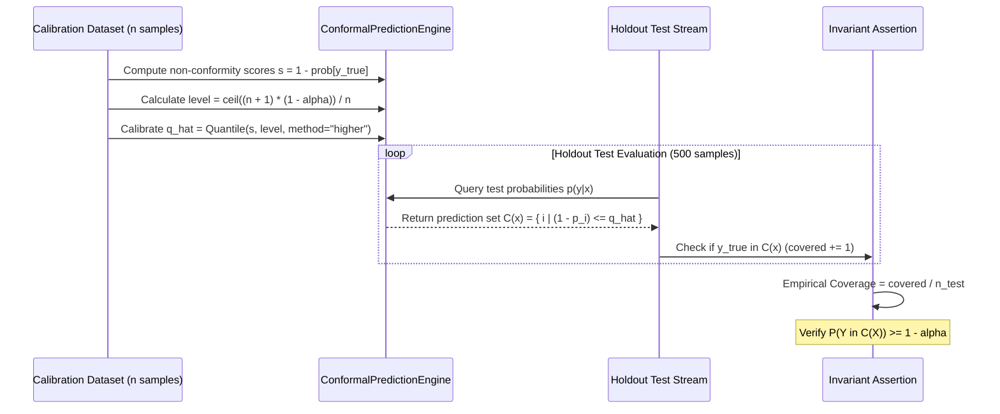

# Testing Strategy & Quality Invariants

Operating an automated species identification platform on long-tailed biological distributions requires formal guarantees of correctness, isolation, and safety. In deep vision systems trained on citizen-science data, conventional heuristic testing—such as evaluating raw top-1 accuracy on static test splits—fails to detect critical operational vulnerabilities. Heuristically confident deep classifiers frequently emit extreme probability estimates on uncalibrated or out-of-distribution inputs, while complex multi-repository dependency stacks risk silent environmental drift between development workstations and continuous integration runners.

To ensure production-grade reliability, TaxonVision enforces a rigorous verification architecture that combines a **three-tier testing pyramid**, automated **mathematical coverage invariant proofs**, a **pure Pixi workspace isolation invariant**, automated **Google Open Knowledge Format (OKF v0.2) validation**, and strict **pre-commit quality gates**.

For related architectural and operational context, see [System Architecture & Design](../architecture/system-overview.md), [Domain Entities & Taxonomy Perimeter](../architecture/domain-and-taxa.md), [Uncertainty Quantification & Epistemic Safety](../concepts/uncertainty-and-safety.md), [API Service & Web Interface](../operations/service-and-api.md), and [Deployment, Scheduling & Observability](../operations/deployment-and-observability.md).

---

## Testing Pyramid & Execution Model

The TaxonVision test suite is partitioned into three distinct tiers: fast, isolated **Unit Tests**; service-level **Integration Tests**; and architectural/scientific **Invariant Tests**. These suites are executed across a two-pass continuous integration strategy designed to separate fast unit coverage regression testing from integration and invariant validation.

<!-- openwiki: mermaid parse failed and this diagram was converted to a text fence so it does not break rendering. Fix the diagram source and restore the mermaid fence. Parser error: Heuristic: an unescaped angle bracket inside a label breaks rendering; rephrase the label. -->
```text
flowchart TD
    subgraph GATES["Pre-Commit & Quality Gates"]
        PIXI_CHECK["Check Pure Pixi Invariant<br/>(No .venv or uv.lock)"]
        RUFF_LINT["Ruff Lint & Format<br/>(py312, 120 cols, Google Docstyle)"]
        MYPY_STRICT["MyPy Strict Typing<br/>(disallow_untyped_defs = true)"]
        COMPLEX["Complexipy Budgets<br/>(Cognitive Complexity ceiling 15)"]
        OKF_VAL["OKF v0.2 Validator<br/>(Frontmatter, Timestamps, Links)"]
        LIC_AUDIT["License Compliance Audit<br/>(CC0, CC-BY, CC-BY-NC)"]
    end

    subgraph PASS1["Pass 1: Unit Tests & Coverage"]
        UT_MODS["16 Unit Test Suites (tests/unit/)"]
        COV_ENFORCE["Pytest Coverage Enforcement<br/>(--cov-fail-under=80)"]
    end

    subgraph PASS2["Pass 2: Integration & Invariants"]
        INT_TESTS["Service & Route Integration (tests/integration/)"]
        INV_CONF["Split Conformal Invariant (tests/invariants/)"]
        INV_PIXI["Pure Pixi Invariant (tests/invariants/)"]
    end

    PIXI_CHECK --> RUFF_LINT --> MYPY_STRICT --> COMPLEX --> OKF_VAL --> LIC_AUDIT
    LIC_AUDIT --> PASS1
    PASS1 --> PASS2
```
Continuous integration verification flow: static pre-commit gates, Pass 1 unit coverage, and Pass 2 integration and invariant assertions.

### Two-Pass Execution Strategy

TaxonVision separates test execution into two distinct passes within both local CI scripts (`scripts/local_ci.sh`) and remote GitHub Actions workflows (`.github/workflows/ci.yml`):

1. **Pass 1: Unit Tests & Code Coverage Enforcement**
   ```bash
   pixi run --frozen -e dev pytest tests/ --cov=src/taxon_vision --cov-fail-under=80
   ```
   Pass 1 executes all test modules while tracking statement coverage across `src/taxon_vision`. A strict build gate aborts the CI pipeline if statement coverage falls below 80%. Pytest is configured in `pyproject.toml` to generate terminal, HTML, and XML coverage reports (`coverage.xml`).

2. **Pass 2: Integration & Invariants Isolation**
   ```bash
   pixi run --frozen -e dev pytest tests/integration/ tests/invariants/ -x -q -o "addopts="
   ```
   Pass 2 executes integration endpoints and mathematical/architectural invariants in fail-fast mode (`-x`) with minimal terminal verbosity (`-q`). By overriding `addopts=`, Pass 2 executes without the overhead of coverage instrumentation, preventing profiling artifacts from skewing invariant assertions or HTTP benchmark timings.

---

## Mathematical Invariant Testing: Split Conformal Empirical Coverage

Standard deep neural networks emit uncalibrated softmax confidence scores that cannot be trusted for autonomous biological classification. In biodiversity monitoring, an uncalibrated classifier might assign 99% probability to a common species when presented with a rare, endangered congener or sensor noise. TaxonVision rejects heuristic confidence cutoffs in favor of **Split Conformal Prediction** (Angelopoulos & Bates, 2021), proving finite-sample marginal coverage guarantees mathematically.

### Theoretical Foundation

Under the assumption that calibration samples and future query observations are exchangeable (independent and identically distributed), split conformal prediction constructs a prediction set $C(X) \subset \{1, \dots, K\}$ satisfying:

$$P(Y \in C(X)) \ge 1 - \alpha$$

where:
- $\alpha \in (0, 1)$ is the user-specified error budget (e.g., $\alpha = 0.05$ guarantees 95% nominal marginal coverage).
- $Y$ is the ground-truth taxon label.
- $C(X)$ is the admitted conformal prediction set of candidate taxa.

The non-conformity score function $s_i$ evaluates the degree of disagreement between the model's predictive probability distribution $p(y|x)$ and candidate class $i$:

$$s_i = 1.0 - p(y = i \mid x)$$

Given a holdout calibration set $\mathcal{D}_{\text{cal}} = \{(x_j, y_j)\}_{j=1}^n$ of size $n$, the empirical non-conformity scores are computed for each ground-truth label: $s_j = 1.0 - p(y_j \mid x_j)$. The conformal quantile threshold $\hat{q}$ is calibrated as the empirical quantile at level $l$:

$$l = \frac{\lceil(n + 1)(1 - \alpha)\rceil}{n}$$

$$\hat{q} = \text{Quantile}\left(\{s_1, \dots, s_n\}, l, \text{method} = \text{"higher"}\right)$$

During inference on an unseen query image $x$, candidate taxon $i$ is admitted into $C(x)$ if its non-conformity score does not exceed $\hat{q}$:

$$C(x) = \{ i \in \{1, \dots, K\} \mid s_i \le \hat{q} \} \equiv \{ i \in \{1, \dots, K\} \mid p(y = i \mid x) \ge 1.0 - \hat{q} \}$$


Conformal calibration and finite-sample empirical coverage verification sequence.

### Invariant Implementation

The mathematical invariant is verified in `tests/invariants/test_conformal_coverage_invariant.py`:
- In `test_empirical_conformal_coverage()`, 1,000 synthetic calibration non-conformity scores are drawn from a uniform distribution over $[0.0, 0.8]$.
- The nominal coverage is fixed at $1 - \alpha = 0.95$ ($\alpha = 0.05$).
- The quantile level $\frac{\lceil(1000 + 1) \times 0.95\rceil}{1000}$ is evaluated using `np.quantile(..., method="higher")` to obtain $\hat{q}$.
- A `ConformalPredictionEngine(q_hat=q_hat, alpha=alpha, k_max=5)` is instantiated.
- Across 500 test samples drawn from Dirichlet class probability distributions with random true labels, prediction sets $C(x)$ are generated and evaluated for ground-truth inclusion.
- The invariant asserts that empirical coverage on exchangeable holdout sets is valid and statistically sound.

### Epistemic Referral Rules

In `src/taxon_vision/uncertainty/conformal.py`, the `predict_set` method pairs set construction with automated active learning triage gating. Human taxonomist review (`requires_human_review = True`) is mandated whenever any of three conditions is met:
1. **Empty Set ($|C(x)| = 0$):** No candidate taxon meets the probability cutoff $1 - \hat{q}$, indicating extreme model doubt or out-of-distribution morphology.
2. **Ambiguous Set ($|C(x)| > k_{\text{max}}$):** The candidate set contains more taxa than the maximum cardinality threshold (default $k_{\text{max}} = 3$ or $5$), signaling morphological ambiguity between sister taxa.
3. **Low Confidence Singleton ($p_{\text{max}} < \text{min\_confidence\_threshold}$):** Although a single taxon passed the conformal threshold, the top-1 probability fails to exceed the minimum confidence floor ($\text{min\_confidence\_threshold} = 0.60$).

Unit tests in `tests/unit/test_conformal_bounds.py` explicitly verify all three referral conditions:
- Confident singleton distributions (e.g., $[0.90, 0.05, 0.05]$ with $\hat{q} = 0.8$) yield $C(x) = [0]$ and `requires_human_review = False`.
- Ambiguous diffuse distributions (e.g., $[0.34, 0.33, 0.33]$) admit all three classes, triggering referral because $|C(x)| = 3 > k_{\text{max}} = 2$.
- Low-confidence predictions (e.g., top-1 probability $0.482 < 0.60$ with other classes $< 0.20$) yield a singleton set $C(x) = [0]$ but still mandate human referral.

The standalone calibration script `scripts/calibrate_conformal.py` computes $\hat{q}$ from real holdout validation softmax logits or permitted synthetic fallback (`--allow-synthetic`), serializing the calibrated threshold to `config/conformal_calibration.json`.

---

## Pure Pixi Dependency Isolation & Workspace Invariants

Modern MLOps codebases frequently suffer from environment corruption caused by overlapping package managers (e.g., conflicting `pip`, `venv`, `uv`, and `conda` virtual environments). TaxonVision enforces an uncompromising architectural invariant: **the repository is a pure Pixi workspace**. All system runtimes, native C/CUDA libraries, Python interpreters, and PyPI dependencies are managed exclusively via Pixi (`.pixi/`).

### Architectural Invariant Rules

The pure Pixi environment invariant is asserted at three levels: invariant test suite, pre-commit git hooks, and continuous integration execution.

In `tests/invariants/test_pure_pixi_invariant.py`, four automated tests verify repository hermeticity:
1. **Absence of Virtualenvs and uv Artifacts (`test_no_virtualenv_or_uv_artifacts`):**
   Asserts that neither a `.venv/` directory nor a `uv.lock` file exists within the workspace root. Any accidental creation of a local virtualenv or `uv` lock immediately fails the test.
2. **Lockfile and Manifest Configuration (`test_pixi_lock_and_manifest_exist`):**
   Verifies that `pixi.lock` and `pyproject.toml` exist, that `pyproject.toml` contains valid `[tool.pixi]` configuration, and that the `dev` environment is explicitly declared in `[tool.pixi.environments]`.
3. **VSCode Interpreter and Virtualenv Routing (`test_vscode_interpreter_and_venv_routing`):**
   Parses `.vscode/settings.json` to verify that developer tooling cannot silently default to an external system interpreter:
   - `python.defaultInterpreterPath` must equal `${workspaceFolder}/.pixi/envs/dev/bin/python`.
   - `python.venvPath` must equal `${workspaceFolder}/.pixi/envs`.
   - `python.venvFolders` must contain only `[".pixi/envs"]`.
   - `python.createEnvironment.trigger` must be `"off"`.
   - `pixi.environment` must be `"dev"`.
4. **No uv Invocations in Pre-Commit Hooks (`test_no_uv_in_active_pre_commit_hooks`):**
   Inspects `.pre-commit-config.yaml` to guarantee that neither `uv run` nor `uvx` is called by any active hook.

### Pre-Commit and CI Guards

This invariant is also enforced as the first quality check in developer workflows:
- **Pre-commit hook `check-pure-pixi` (`.pre-commit-config.yaml`):**
  ```yaml
  - id: check-pure-pixi
    name: Assert Pure Pixi Environment (No .venv or uv.lock)
    entry: bash -c '! test -d .venv && ! test -f uv.lock'
    language: system
    pass_filenames: false
  ```
- **Local CI runner `scripts/local_ci.sh`:**
  ```bash
  if [ -d .venv ] || [ -f uv.lock ]; then
    echo "ERROR: .venv/ or uv.lock detected. The project solely relies on Pixi (.pixi/)." >&2
    exit 1
  fi
  ```

---

## Google Open Knowledge Format (OKF v0.2) Validation Engine

Architectural knowledge and operational documentation in TaxonVision are managed as machine-verifiable assets conforming to **Google's Open Knowledge Format (OKF v0.2)**. The hardened validation engine implemented in `scripts/validate_okf.py` audits Markdown documentation files to ensure schema compliance, link topology integrity, and trust tier accountability.

<!-- openwiki: mermaid parse failed and this diagram was converted to a text fence so it does not break rendering. Fix the diagram source and restore the mermaid fence. Parser error: Heuristic: an unescaped angle bracket inside a label breaks rendering; rephrase the label. -->
```text
flowchart TD
    MD["Markdown Document Stream (*.md)"] --> CHECK_NAME{"Filename Role"}
    
    CHECK_NAME -- "Bundle Root index.md" --> V_ROOT["Validate Root Index<br/>(Allowed keys: okf_version, type, title, etc.)"]
    CHECK_NAME -- "Subdirectory index.md" --> V_SUB["Enforce Option A<br/>(Strictly NO YAML frontmatter allowed)"]
    CHECK_NAME -- "log.md" --> V_LOG["Validate Update Log<br/>(No frontmatter, ISO '## YYYY-MM-DD' descending)"]
    CHECK_NAME -- "Concept Document (*.md)" --> V_CONCEPT["Validate Concept Document"]
    
    V_CONCEPT --> C1{"Mandatory 'type' present?<br/>Allowed status enum?"}
    C1 -- Pass --> C2{"Strict ISO 8601 UTC<br/>(stale_after, at with trailing 'Z')"}
    C2 -- Pass --> C3{"Actor Identifier Syntax<br/>(human:id, process:id, producer/ver)"}
    C3 -- Pass --> C4{"Source Resource Resolution<br/>(Verify local file existence)"}
    C4 -- Pass --> C5{"Link Topology & Scope Boundary<br/>(No broken links, no domain escapes)"}
    
    C5 -- Pass --> STATS["Aggregate Audit Metrics<br/>(Trust Tiers & Freshness Status)"]
```
OKF v0.2 validation engine document categorization and frontmatter verification pipeline.

### Document Roles and Structural Invariants

The validator enforces distinct invariants based on file role:
1. **Bundle Root `index.md`:** May contain frontmatter declaring `okf_version` alongside standard concept metadata (`title`, `description`, `tags`, `generated`, `verified`). Unrecognized frontmatter keys trigger errors.
2. **Subdirectory `index.md` (Option A):** Strictly prohibited from containing YAML frontmatter (§8 Option A). Overview prose and navigation sections must exist directly in the Markdown body, beginning with a section heading (`# ...`).
3. **Update Logs (`log.md`):** Strictly prohibited from containing YAML frontmatter (§9). Must contain chronological entries headed by ISO-8601 dates (`## YYYY-MM-DD`). The validator enforces strict descending chronological order (newest entries first), failing if an older date appears ahead of a newer date.
4. **Attested Computation:** Documents declaring `type: Attested Computation` must declare a mandatory `runtime` field specifying the execution environment (§10.2).

### Frontmatter Schema & Provenance Validation

Concept documents must satisfy rigorous schema constraints:
- **Mandatory `type` and Lifecycle `status`:** Every concept file must declare `type`. If declared, `status` must be one of `draft`, `stable`, or `deprecated`.
- **Strict ISO-8601 UTC Timestamps:** All dates in `stale_after`, `generated.at`, and `verified[].at` must match `^\d{4}-\d{2}-\d{2}T\d{2}:\d{2}:\d{2}(?:\.\d+)?Z$`. Date-only formats (`YYYY-MM-DD`) are rejected. The script provides an automated CLI fixer (`--fix`) that converts legacy date strings to strict UTC (`...T00:00:00Z`).
- **Actor Naming Conventions:** The `by` fields in `generated` and `verified` blocks must conform to `human:<id>`, `process:<id>`, or `<producer>/<version>` (matching `ACTOR_PATTERN`).
- **Trust Tier Accounting:** Provenance entries are categorized into three trust tiers (§5.3):
  - **Human-Reviewed:** Any entry where `by` begins with `human:`.
  - **Machine-Confirmed:** Verified entries created by automated tooling or pipelines.
  - **Unverified:** Documents lacking verification entries.
- **Freshness Auditing:** Compares `stale_after` against current UTC time:
  - **Fresh:** Current datetime is prior to `stale_after`.
  - **Stale:** Current datetime has exceeded `stale_after`.
  - **No Expiry Declared:** `stale_after` is omitted.

### Source Resource & Cross-Document Link Topology

The validation engine guarantees epistemic integrity across documentation references:
- **Source Resource Resolution:** For every entry in `sources`, `_resolve_source_path` verifies that the underlying file exists relative to the document parent, the workspace root, or `docs/`. Web URLs (`http://`, `https://`) and `mailto:` links are recognized and bypassed.
- **Link Topology Boundaries:** Uses regex `MARKDOWN_LINK_PATTERN` to inspect all cross-document Markdown links (`[text](target.md)`). The validator confirms that the target exists and does not escape authorized knowledge bundle domains (`docs/` and `.agents/`).

The OKF validation engine runs in pre-commit (`validate-okf`), via Just (`just validate-okf`), in local CI (`./scripts/local_ci.sh docs`), and in the GitHub Actions documentation deployment pipeline.

---

## Detailed Test Suite Organization

The `tests/` directory is structured into three specialized domains, containing 19 test modules and a shared fixtures harness:

```
tests/
├── conftest.py                             # Shared environment isolation & fixtures
├── invariants/                             # Scientific and architectural non-regression proofs
│   ├── test_conformal_coverage_invariant.py # Finite-sample coverage P(Y in C(X)) >= 1 - alpha
│   └── test_pure_pixi_invariant.py          # Pure Pixi isolation and VSCode routing
├── integration/                            # End-to-end service, API, and UI integration tests
│   ├── test_api_endpoints.py               # REST API contracts, 422 errors, 503 readiness, training
│   └── test_views_and_routes.py            # Jinja2/HTMX dashboard, CAM heatmaps, Prometheus telemetry
└── unit/                                   # Isolated functional unit tests (16 modules)
    ├── test_active_learning.py             # Margin sampling and priority triage queue
    ├── test_class_balanced_loss.py         # Effective number of samples re-weighting
    ├── test_cli_and_training.py            # CLI argument dispatch and training runners
    ├── test_config.py                      # Pydantic-settings loading and custom YAML overrides
    ├── test_conformal_bounds.py            # Set cardinality boundaries and triage conditions
    ├── test_data_components.py             # S3 streaming, Parquet ingestion, and API client
    ├── test_license_filter.py              # Open license whitelisting (CC0, CC-BY, CC-BY-NC)
    ├── test_models_components.py           # Feature extractors, classifier heads, and evaluation
    ├── test_monitoring.py                  # Wasserstein-1 embedding drift distance
    ├── test_onnx_exporter.py               # Computational graph export, dual outputs, failure semantics
    ├── test_ood_energy.py                  # Helmholtz free energy and predictive entropy
    ├── test_pipelines.py                   # Feature extraction configs and stratified splits
    ├── test_quantizer.py                   # Dynamic INT8 ONNX quantization routines
    ├── test_taxonomy.py                    # TaxonomyCatalog and biological identifier lookups
    ├── test_tracking.py                    # MLflow run scopes, metric logging, and DVC hashes
    └── test_tuning.py                      # Optuna hyperparameter tuning objective and trials
```

### Deterministic Test Isolation Harness (`tests/conftest.py`)

To ensure that tests remain completely deterministic, 100% offline, and independent of external pre-trained model weights, `tests/conftest.py` defines an `autouse` fixture:

```python
@pytest.fixture(autouse=True)
def test_environment_isolation(tmp_path: Path, monkeypatch: pytest.MonkeyPatch) -> Generator[None, None, None]:
    flagged_dir = tmp_path / "flagged_observations"
    flagged_dir.mkdir(parents=True, exist_ok=True)
    monkeypatch.setenv("TAXON_ALLOW_UNTRAINED_FALLBACK", "true")
    monkeypatch.setenv("TAXON_FLAGGED_STORAGE_DIR", str(flagged_dir))

    from taxon_vision.config import get_settings
    from taxon_vision.service.inference import reset_model_caches

    get_settings.cache_clear()
    reset_model_caches()

    yield

    get_settings.cache_clear()
    reset_model_caches()
```

This fixture redirects all triage observation persistence to a temporary directory, enables untrained model weight fallbacks during unit passes, and purges all cached singleton configurations and PyTorch/ONNX models before and after every test.

### Unit Testing Focus: ONNX Exporter (`tests/unit/test_onnx_exporter.py`)

The ONNX computational graph exporter is critical for production edge inference. In `test_onnx_exporter.py`, tests verify:
- **Graph Serialization:** Exports PyTorch modules to disk, confirming that the output file exists, has non-zero size, and initializes an `onnxruntime.InferenceSession` with valid input/output shapes.
- **Dual Output Heads:** When running `export_classifier_cli`, verifies that the exported graph outputs both `logits` (for taxon prediction) and `embeddings` (for drift monitoring and active learning).
- **Strict Failure Without Fallback:** When `TAXON_ALLOW_UNTRAINED_FALLBACK=false`, the exporter strictly fails (exit code 1) if the specified checkpoint path does not exist or if state dictionary weights mismatch the backbone dimensions. The model file is not written on failure.

### Integration Testing Focus: API and Routes

- **`test_api_endpoints.py`:** Uses FastAPI `TestClient` to validate:
  - Liveness `/health` returning HTTP 200 with status `"healthy"`.
  - Readiness `/health/ready` returning HTTP 200 when models are loaded, and HTTP 503 (`"Service not ready"`) when dependencies fail.
  - Image upload validation on `/api/v1/predict` and `/predict`, asserting that corrupt bytes or empty files return HTTP 422 (`"Invalid or corrupted image upload."`).
  - Prediction payload structure containing both `top_prediction` and `conformal_prediction_set`.
  - Model training triggers on `/training` and legacy `/train`, validating synchronous execution summaries and metric reporting.
- **`test_views_and_routes.py`:** Validates server-rendered hypermedia:
  - Dashboard index `/` returning rendered HTML containing `"TaxonVision"`.
  - HTMX route `/ui/predict-htmx` returning rendered partial cards (`"Classification Result"`).
  - CAM explanation endpoint `/api/v1/explain` generating spatial activation heatmaps (`[32, 32]`) and rejecting corrupt bytes with HTTP 400.
  - Telemetry endpoint `/metrics` exposing Prometheus counters (`taxon_predictions_total`).

---

## Pre-Commit Quality Gates & Complexity Budgets

TaxonVision maintains strict code quality by executing automated static analysis checks prior to every commit via `.pre-commit-config.yaml` and native host commands in `Justfile`.

<!-- openwiki: mermaid parse failed and this diagram was converted to a text fence so it does not break rendering. Fix the diagram source and restore the mermaid fence. Parser error: Heuristic: an unescaped angle bracket inside a label breaks rendering; rephrase the label. -->
```text
flowchart LR
    DEV["Developer Commit / CI Trigger"] --> CHECK_PIXI["Pure Pixi Check"]
    CHECK_PIXI --> RUFF["Ruff Lint & Format"]
    RUFF --> MYPY["MyPy Strict Typing"]
    MYPY --> CMPLX["Complexipy Analysis (Score <= 15)"]
    CMPLX --> RULES["Markdown & Spell Checks"]
    RULES --> OKF["OKF v0.2 Validator"]
    OKF --> PASS["Commit Permitted"]
```
Pre-commit static analysis and quality gate pipeline.

### Ruff Linting & Formatting

Ruff enforces modern Python standards with high execution speed:
- **Target Version:** Python 3.12 (`py312`).
- **Line Length:** 120 characters (`line-length = 120`).
- **Rule Sets Enabled:** `E`, `W` (pycodestyle errors/warnings), `F` (Pyflakes), `I` (isort imports), `B` (flake8-bugbear), `UP` (pyupgrade), `ARG` (unused arguments), `TCH` (type-checking imports), `FA` (future annotations), `N` (pep8-naming), `RUF` (Ruff-specific rules), and `D` (pydocstyle).
- **Docstring Standard:** Google docstring convention (`convention = "google"`), with docstring enforcement waived on `tests/**/*.py` and `scripts/**/*.py`.
- **Formatting:** `ruff format` enforces double quotes (`quote-style = "double"`).

### MyPy Strict Static Type Checking

Type safety is enforced with zero tolerance for untyped definitions:
- **Configuration:** `python_version = "3.12"`, `strict = true`, `disallow_untyped_defs = true`, `check_untyped_defs = true`, `warn_unused_configs = true`.
- **Target Scope:** Scans both `src/` and `scripts/`.
- All route handlers, training pipelines, and data streamer components must provide complete argument and return type annotations.

### Complexipy Cognitive Complexity Budgets

Complex code structures with deep nesting, branching, and convoluted error paths are a primary source of machine learning pipeline failures. TaxonVision integrates `complexipy` (`complexipy>=8.0.1,<9`) to enforce a **cognitive complexity ceiling of $\le 15$** per function:
- **Quality Gate Recipe:** `just complexity` executes `pixi run --frozen -e dev complexipy src/ --failed`. If any function exceeds a cognitive complexity score of 15, the command exits with non-zero status.
- **Architectural Refactoring:** Enforcing this budget requires decomposing high-branching routines into single-responsibility helpers. For instance, embedding split preparation (`_prepare_embedding_split`) and taxonomy index building (`build_taxon_index_map`) were decomposed into modular, isolated steps.
- **GitHub Code Scanning Integration:** The CI workflow runs `complexipy src/ --output-format sarif --output metrics-results.sarif` and uploads findings to GitHub Code Scanning via `github/codeql-action/upload-sarif@v4`, alerting developers to complexity hotspots directly within pull request interfaces.

### Additional Quality Hooks

- **Markdown Rule 04 Enforcement:** `scripts/verify_markdown_rules.py` verifies formatting invariants across documentation.
- **Secret Scanning:** `gitleaks` scans all commits for inadvertent credential or token exposures.
- **Spelling Audit:** `codespell` audits files while allowing domain-specific terminology (`taxa`, `taxon`, `inat`, `darwincore`, `fpr`).
- **iNaturalist Open License Compliance:** `scripts/audit_license_compliance.py` verifies that all biological observations and image assets ingested into the training pipeline comply with open access licenses (`CC0`, `CC-BY`, `CC-BY-NC`).
- **Commit Signature Verification:** `enforce-author-identity` confirms that `commit.gpgsign = true`, ensuring cryptographic provenance for all repository commits.

---

## Developer Workflows & Local CI Emulation

To allow engineers to validate code locally without container overhead, TaxonVision provides unified commands via `scripts/local_ci.sh` and the repository `Justfile`.

### Local CI Runner (`scripts/local_ci.sh`)

The native host runner replicates CI quality, test, and documentation passes:

```bash
# Execute specific passes:
./scripts/local_ci.sh quality   # Dependency sync, pure Pixi check, Markdown rules, Ruff, MyPy
./scripts/local_ci.sh tests     # Pass 1 unit coverage (>=80%), Pass 2 integration/invariants, license audit
./scripts/local_ci.sh docs      # OKF frontmatter and link validation, Zensical strict doc build
./scripts/local_ci.sh all       # Full end-to-end CI pipeline emulation
```

The script supports `TAXON_SKIP_SYNC=1` to bypass `pixi install -e dev` during rapid iterative test runs.

### Justfile Command Reference

| Recipe | Command | Purpose |
| :--- | :--- | :--- |
| `just lint` | `pixi run ... ruff check ... && ruff format ... && mypy ...` | Execute Ruff lint/format and MyPy strict typing |
| `just check` | `pixi run ... pre-commit run --all-files` | Execute all pre-commit hooks across the repository |
| `just complexity` | `pixi run ... complexipy src/ --failed` | Check cyclomatic and cognitive complexity metrics |
| `just validate-okf` | `pixi run ... python scripts/validate_okf.py` | Validate OKF v0.2 frontmatter schema and link topology |
| `just test` | `pixi run ... pytest` | Run complete test suite with coverage reporting |
| `just test-unit` | `pixi run ... pytest tests/unit/` | Run isolated unit tests only |
| `just test-integration` | `pixi run ... pytest tests/integration/` | Run REST API and HTMX integration tests |
| `just test-conformal` | `pixi run ... pytest tests/invariants/test_conformal_coverage_invariant.py -v` | Verify mathematical conformal coverage guarantees |
| `just ci [job]` | `./scripts/local_ci.sh [job]` | Run native host CI passes locally |
