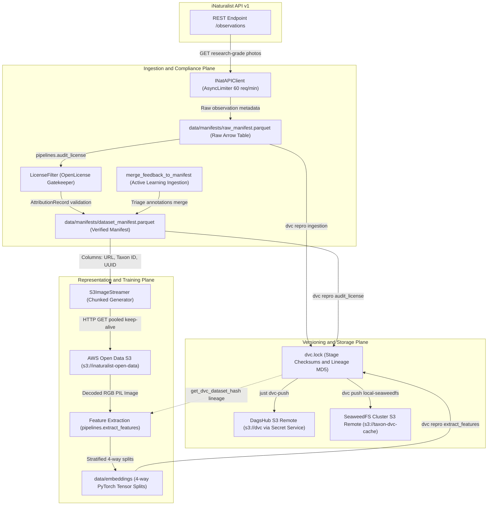

# Data Ingestion & Dataset Versioning

The data ingestion and dataset versioning subsystem provides the reproducible, auditable foundation for the TaxonVision machine learning pipeline. Biodiversity image datasets present unique operational challenges: global citizen-science repositories contain petabytes of media with skewed class distributions, diverse copyright licenses, and variable community identification quality. TaxonVision addresses these challenges through a zero-disk streaming architecture that pairs automated licensing verification with cryptographic dataset lineage tracking.

Rather than bulk-downloading tens of gigabytes of image binaries to local workstations or build runners, TaxonVision separates lightweight observation metadata from image payloads. Metadata is ingested via an asynchronous, rate-limited iNaturalist API client, filtered against strict intellectual property criteria, and serialized into high-performance Apache Arrow Parquet manifests tracked by Data Version Control (DVC). Deep learning representation extractors and training routines consume these manifests directly, streaming medium-resolution imagery on demand from the AWS Open Data S3 registry via HTTP connection pooling.

For surrounding architectural context, see [Domain Entities & Taxonomy Perimeter](../architecture/domain-and-taxa.md), [System Overview](../architecture/system-overview.md), [Model Training & Tracking](model-training-and-tracking.md), and [Deployment & Observability](../operations/deployment-and-observability.md).

---

## Architectural Data Flow

The following diagram illustrates the progression of biological observation data from public repositories into immutable tabular manifests, S3 image streaming generators, 4-way representation splits, and synchronized cloud storage:



Data progression flowchart illustrating observation metadata ingestion, Parquet manifest persistence, DVC remote synchronization, S3 image streaming, and feature extraction.

---

## Asynchronous iNaturalist API Client

Metadata retrieval is implemented by the `INatAPIClient` class in `src/taxon_vision/data/inat_client.py`. The client interfaces with the iNaturalist REST API v1 (`https://api.inaturalist.org/v1`) while strictly adhering to community terms of service.

### Rate Limiting and Leaky-Bucket Throttling

The iNaturalist API v1 enforces an aggressive rate limit of 60 requests per minute (1 request per second) per IP address, with burst traffic penalized by temporary bans. The `INatAPIClient` enforces compliance at the transport layer by initializing an asynchronous rate limiter:

```python
self.limiter = AsyncLimiter(max_rate=max_requests_per_minute, time_period=60.0)
```

Prior to dispatching any GET request via `httpx.AsyncClient`, the client enters `async with self.limiter:`. This leaky-bucket scheduling prevents connection bursts when iterating through multiple catalog taxa across long-running ingestion jobs.

### Quality Filtering & Resolution Standardization

Biological foundation models require high label purity. To guarantee taxon identification accuracy, `fetch_observations` queries the `/observations` endpoint with targeted filter parameters:

* `taxon_id`: Authoritative Darwin Core taxonomic identifier (e.g., `48662` for *Danaus plexippus*).
* `quality_grade`: Hardcoded to `"research"`. This parameter guarantees that community taxonomists have reached consensus on the organism's species identification.
* `has[]`: Hardcoded to `"photos"`, eliminating text-only occurrences.
* `per_page`: Number of observation records retrieved per request page (configured via `settings.ingestion.per_page`).

Default observation thumbnails returned by iNaturalist use a square crop (`square`, $75 \times 75$ pixels) unsuitable for neural feature extraction. The client intercepts image locators and rewrites the URL path segment:

```python
photo.get("url", "").replace("square", "medium")
```

This upgrades locators to medium resolution ($500\text{ px}$ along the longest dimension), providing sufficient spatial acuity for pre-trained vision backbones (such as DINOv3 or MobileNetV4) while remaining within AWS Open Data CDN delivery quotas.

Network calls are wrapped using an asynchronous `httpx.AsyncClient` with a 10.0-second timeout, raising standard `httpx.HTTPStatusError` on non-2xx responses or `httpx.RequestError` on connectivity failures.

---

## Licensing Auditing & Photographer Attribution

Citizen-science imagery is contributed under varied intellectual property designations, ranging from public domain dedications to restrictive "All Rights Reserved" copyrights. Ingesting proprietary imagery into machine learning pipelines creates legal risk and violates open science licensing terms. The `LicenseFilter` class (`src/taxon_vision/data/license_filter.py`) and Stage 2 pipeline (`src/taxon_vision/pipelines/audit_license.py`) enforce strict copyright compliance and attribution retention before records enter the training manifest.

### Permitted Licenses

TaxonVision accepts only Creative Commons licenses that permit model training and derived research works, as defined in `src/taxon_vision/domain/license.py`:

* `OpenLicense.CC0`: Public domain dedication (`"CC0"`).
* `OpenLicense.CC_BY`: Creative Commons Attribution (`"CC-BY"`).
* `OpenLicense.CC_BY_NC`: Creative Commons Attribution-NonCommercial (`"CC-BY-NC"`).

The static method `LicenseFilter.is_license_permitted(license_str)` normalizes raw license strings by trimming whitespace, converting to lowercase, and replacing underscores with hyphens before checking membership in `ALLOWED_LICENSES = {"cc0", "cc-by", "cc-by-nc"}`. Inadmissible variants (such as `CC-BY-ND` NoDerivatives, `CC-BY-SA` ShareAlike, or unstated copyrights) return `False` and are rejected.

### Static Domain Anti-Scraping Protection

To prevent scraping of private or unverified assets directly from iNaturalist web endpoints, `LicenseFilter.is_static_domain_prohibited` inspects the asset locator:

```python
if "static.inaturalist.org" in image_url and not is_open_dataset_verified:
    return True
```

If an image locator points to `static.inaturalist.org` without prior verification against an official open data registry manifest (`is_open_dataset_verified = True`), the record is rejected. Legitimate mirrors such as `inaturalist-open-data.s3.amazonaws.com` pass verification automatically.

### Attribution Record Preservation

Under Creative Commons terms, downstream users must retain creator credits, license variants, and source pointers. For each compliant record, `LicenseFilter.process_record` constructs a validated Pydantic `AttributionRecord`:

```python
AttributionRecord(
    photographer_name=photographer,
    license_code=OpenLicense(license_str),
    license_url=str(raw.get("license_url", "https://creativecommons.org/licenses/")),
    observation_uuid=str(raw.get("observation_id") or raw.get("observation_uuid") or ""),
    source_portal="iNaturalist",
)
```

In `src/taxon_vision/pipelines/audit_license.py`, `verify_observation_compliance` additionally enforces that `attribution` or `photographer_name` contains at least 3 non-whitespace characters. Non-compliant observations are recorded in `reports/license_audit.json` with descriptive rejection reasons, while compliant records proceed to the verified manifest.

---

## Parquet Manifest Generation & Active Learning Feedback Loop

Data ingestion coordinates initial API harvesting and ongoing human-in-the-loop triage feedback into immutable tabular manifests.

### Manifest Schema & Arrow Serialization

The metadata manifests are serialized as Apache Arrow Parquet files using Polars:

* `data/manifests/raw_manifest.parquet`: Unfiltered candidate records emitted by Stage 1 (`taxon_vision.pipelines.ingest`).
* `data/manifests/dataset_manifest.parquet`: Verified open-licensed records emitted by Stage 2 (`taxon_vision.pipelines.audit_license`).

The resulting Parquet file exhibits the following tabular structure:

| Field Name | Polars / Arrow Type | Description |
|---|---|---|
| `observation_uuid` | `String` / `Utf8` | Unique Darwin Core observation identifier. |
| `taxon_id` | `Int64` | External taxonomic identifier assigned by iNaturalist. |
| `image_url` | `String` / `Utf8` | Standardized medium-resolution image locator URL. |
| `photographer_name` | `String` / `Utf8` | Retained creator credit for licensing attribution. |
| `license_code` | `String` / `Utf8` | Normalized Creative Commons code (`CC0`, `CC-BY`, `CC-BY-NC`). |
| `license_url` | `String` / `Utf8` | Direct URL to Creative Commons legal deed. |

Using Apache Arrow Parquet provides significant performance advantages over CSV or JSON lines: columnar projection allows training loops to extract `(observation_uuid, taxon_id, image_url)` without parsing text fields, compression bounds manifest storage to kilobytes ($< 500\text{ KB}$ for 1,689 catalog observations), and schema types remain strictly enforced.

### Active Learning Feedback Ingestion & Manifest Merging

When the production serving engine encounters an observation whose negative Helmholtz free energy exceeds the out-of-distribution threshold $\tau_{\text{OOD}}$ or whose Split Conformal prediction set is empty or ambiguous ($|C(X)| > k_{\text{max}}$), the specimen is routed to human experts for taxonomic verification. Once annotated in Label Studio, these high-information specimens are reintroduced into the training manifest without violating open-licensing mandates or corrupting existing Parquet tables.

The module `src/taxon_vision/active_learning/feedback.py` implements this gatekeeper boundary via `merge_feedback_to_manifest()`:

1. **Bidirectional Taxonomic Resolution (`load_taxa_mappings`)**: Parses `config/taxa_catalog.yaml` into a `TaxaMappings` container mapping lowercase scientific names, vernacular common names, and raw integer IDs to canonical iNaturalist `taxon_id` integers in $\mathcal{O}(1)$ time.
2. **Out-of-Distribution Separation (`parse_single_task_annotation`)**: If an expert flags an observation as `"Out of Distribution (Non-Target / Novel Organism)"`, `ParsedTaskAnnotation` sets `is_ood=True` and `record=None`, preventing novel background species from polluting closed-set classification heads.
3. **Strict License & Attribution Enforcement (`_validate_licensing_and_attribution`)**: Asserts that `license_code` belongs to `PERMITTED_LICENSES = frozenset({"cc0", "cc-by", "cc-by-nc"})` and that `photographer_name`, `observation_uuid`, and `image_url` are non-empty.
4. **Idempotent UUID Deduplication & Atomic Write (`_atomic_write_manifest`)**: Loads `data/manifests/dataset_manifest.parquet`, filters out any `observation_uuid` already present, appends newly verified records, and writes to a temporary file before executing an atomic POSIX `Path.replace()`. It returns a typed `FeedbackMergeResult` (`new_records_added`, `ood_records_skipped`, `total_manifest_records`, `status`), which Apache Airflow retraining DAGs inspect to trigger downstream feature extraction.

---

## AWS Open Data S3 Streaming Reader

Storing millions of biological training images locally exhausts workstation SSDs and inflates cloud compute provisioning time. TaxonVision solves this via `S3ImageStreamer` (`src/taxon_vision/data/s3_streamer.py`), a lazy streaming reader that fetches images directly from the AWS Open Data iNaturalist S3 registry in memory during training and feature extraction.

### Architecture & Memory Bounds

`S3ImageStreamer` initializes by reading the Parquet manifest into memory using Polars:

```python
streamer = S3ImageStreamer(manifest_path="data/manifests/dataset_manifest.parquet")
```

The generator method `stream_images(limit, shuffle, balanced, seed, max_workers)` yields tuples of:

$$(u_i, t_i, I_i) \in (\text{UUID}, \text{TaxonID}, \text{PIL.Image})$$

Because `stream_images` is a lazy Python generator, only active image buffers remain allocated in RAM at any given moment. Disk usage is zero, eliminating temporary directory thrashing.

### Connection Pooling & Transient Error Handling

To maximize network throughput over remote endpoints, `create_streaming_http_client` configures persistent HTTP keep-alive connections:

* `limits = httpx.Limits(max_connections=cfg.http_max_connections, max_keepalive_connections=cfg.http_keepalive_connections)`
* `transport = httpx.HTTPTransport(retries=cfg.http_max_retries)`
* `timeout = httpx.Timeout(cfg.http_timeout_seconds)`

When downloading images, `fetch_image_with_retry` and `_attempt_http_get` classify HTTP status codes. If a transient error occurs (`status_code == 429` or $500 \le \text{status} < 600$), the streamer performs exponential backoff:

$$\tau_{\text{backoff}} = \text{base\_delay} \times 2^{\text{attempt}} + \text{jitter}$$

Permanent client errors (e.g., HTTP 404) or corrupted byte payloads cause `_fetch_record_image` to log a warning and return `None`, allowing the generator to drop bad samples without halting the pipeline.

### Sequential vs. Concurrent Streaming Modes

The reader automatically selects between two streaming modes:

* **Sequential Streaming (`_stream_sequential`)**: Activated when `max_workers <= 1` or dataset length $\le 2$. Reuses a single persistent `httpx.Client` connection across requests to reduce TCP handshake overhead.
* **Concurrent Streaming (`_stream_concurrent`)**: Activated when `max_workers > 1`. Uses Python's `concurrent.futures.ThreadPoolExecutor` with worker concurrency up to `max_workers` (default 8). Each worker thread maintains a dedicated thread-local HTTP client via `_WorkerTLS`. Records are processed in bounded chunks ($\text{chunk\_size} = \max(1, \min(32, N))$) via `executor.map`, yielding decoded RGB PIL images as worker threads complete downloads.

### Balanced Manifest Sampling

Real-world citizen science observations follow an extreme long-tail distribution: common urban species receive tens of thousands of observations, whereas rare taxa have sparse records. `_prepare_balanced_manifest(df, config: StreamSelectionConfig)` equalizes representation during streaming:

1. **Taxon Partitioning**: Queries unique taxa present in the manifest:
   $$K = |\{t \mid t \in \text{df}[\text{"taxon\_id"}]\}|$$
2. **Per-Taxon Allocation**: Computes an equal ceiling quota:
   $$N_{\text{per\_taxon}} = \max\left(1, \left\lfloor\frac{\text{limit} + K - 1}{K}\right\rfloor\right)$$
3. **Partition Sampling**: Filters the dataframe for each taxon ID $k$. If `shuffle=True`, it samples the partition using `df.sample(fraction=1.0, shuffle=True, seed=config.seed)` before taking the top $N_{\text{per\_taxon}}$ records.
4. **Reassembly & Truncation**: Concatenates all taxon slices with `pl.concat`, optionally reshuffles the entire collection, and slices to the exact requested `limit`.

---

## Feature Extraction & 4-Way Embedding Caching

During Stage 3 (`taxon_vision.pipelines.extract_features`), foundation vision models convert streamed biological images into dense representation vectors.

### Foundation Backbones & Forward Passes

TaxonVision supports multiple vision foundation backbones initialized via `taxon_vision.models.factory.create_feature_extractor`:

* **DINOv3 ViT-S (`dinov3_vits14`)**: 384-dimensional representation space.
* **BioCLIP-2 (`bioclip_vit_base_patch16_224`)**: Domain-specific taxonomic embedding space.
* **DINOv2 (`dinov2_vits14`)**: Self-supervised representation baseline.
* **MobileNetV4 (`mobilenetv4_conv_small`)**: Edge-optimized feature extractor.

The feature extraction trunk is strictly frozen ($\nabla_\theta = 0$). Forward passes in `extract_batch_representations` are executed under `torch.no_grad()`. Pre-normalized penultimate activations are returned, preserving activation magnitudes so downstream drift detection (`data_drift.py`) can evaluate 1D Wasserstein-1 norm drift without collapse.

### Dense Taxonomic Mapping

External iNaturalist identifiers are arbitrary, non-contiguous integers (e.g., Western Honey Bee is `47219`, Gray Wolf is `47144`). Machine learning loss functions (`CrossEntropyLoss`, `ClassBalancedLoss`) require dense integer class indices $y \in [0, K-1]$.

In `extract_features.py`, `build_taxon_index_map(catalog)` dynamically constructs an authoritative mapping from `config/taxa_catalog.yaml`, mapping external IDs and any defined `inat_aliases` to continuous dense indices:

$$\phi: \text{TaxonID} \rightarrow \{0, 1, \dots, K-1\}$$

Any observation in the manifest whose `taxon_id` cannot be mapped through $\phi$ is rejected prior to feature extraction.

### Stratified 4-Way Dataset Partitioning

`create_stratified_embedding_split` partitions extracted representations into four stratified splits:

1. **Train Split (`train_embeddings.pt`)**: Consumed by classification head training (default 70%).
2. **Validation Split (`val_embeddings.pt`)**: Consumed by early stopping and Optuna Bayesian HPO sweeps (default 10%).
3. **Calibration Split (`cal_embeddings.pt`)**: Reserved exclusively for post-quantization Split Conformal Prediction nonconformity score quantile calibration and Helmholtz OOD energy threshold estimation (default 10%).
4. **Test Split (`test_embeddings.pt`)**: Holdout evaluation set for Pareto efficiency analysis and coverage auditing (default 10%).

The split enforces a cardinality invariant ($\ge 2$ classes required). It calculates empirical sample frequencies per class from training labels:

$$n_c = \sum_{i \in \mathcal{D}_{\text{train}}} \mathbb{I}(y_i = c)$$

and populates the `EmbeddingSplit` dataclass (`train_embeddings`, `train_labels`, `val_embeddings`, `val_labels`, `cal_embeddings`, `cal_labels`, `test_embeddings`, `test_labels`, `samples_per_class`). The `samples_per_class` vector is directly consumed by `ClassBalancedLoss` to compute effective sample weights:

$$W_c = \frac{1 - \beta}{1 - \beta^{n_c}}$$

Artifacts are serialized to disk as discrete PyTorch tensor dictionaries under `data/embeddings/`, as well as supporting memory-mapped / streaming array formats for fast zero-copy tensor loading.

---

## DVC Dataset Versioning & Dual-Remote Synchronization

TaxonVision tracks datasets and model artifacts using Data Version Control (DVC). Manifests, intermediate embeddings, and model weights are tracked outside Git while maintaining strict version synchronization.

### Pipeline Dependency Graph in `dvc.yaml`

The DVC pipeline configuration (`dvc.yaml`) formalizes the data ingestion, license audit, and feature extraction stages:

```yaml
stages:
  ingestion:
    frozen: true
    cmd: >-
      pixi run -e dev python -m taxon_vision.pipelines.ingest
      --out data/manifests/raw_manifest.parquet
    deps:
      - config/taxa_catalog.yaml
      - src/taxon_vision/data/inat_client.py
      - src/taxon_vision/pipelines/ingest.py
    params:
      - ingestion.per_page
      - ingestion.taxa_to_fetch
    outs:
      - data/manifests/raw_manifest.parquet

  audit_license:
    cmd: >-
      pixi run -e dev python -m taxon_vision.pipelines.audit_license
      --manifest data/manifests/raw_manifest.parquet
      --out-manifest data/manifests/dataset_manifest.parquet
      --out reports/license_audit.json
    deps:
      - data/manifests/raw_manifest.parquet
      - src/taxon_vision/data/license_filter.py
      - src/taxon_vision/domain/license.py
      - src/taxon_vision/pipelines/audit_license.py
    outs:
      - data/manifests/dataset_manifest.parquet
    metrics:
      - reports/license_audit.json:
          cache: false

  extract_features:
    cmd: >-
      pixi run -e dev python -m taxon_vision.pipelines.extract_features
      --extractor ${model.extractor}
      --image-size ${model.image_size}
      --batch-size ${feature_extraction.batch_size}
      --val-split ${feature_extraction.val_split}
      --cal-split ${feature_extraction.cal_split}
      --test-split ${feature_extraction.test_split}
      --manifest data/manifests/dataset_manifest.parquet
      --out-dir data/embeddings
    deps:
      - config/taxa_catalog.yaml
      - data/manifests/dataset_manifest.parquet
      - src/taxon_vision/data/s3_streamer.py
      - src/taxon_vision/models/factory.py
      - src/taxon_vision/pipelines/extract_features.py
    params:
      - feature_extraction.batch_size
      - feature_extraction.cal_split
      - feature_extraction.test_split
      - feature_extraction.val_split
      - model.extractor
      - model.image_size
    outs:
      - data/embeddings/train_embeddings.pt
      - data/embeddings/val_embeddings.pt
      - data/embeddings/cal_embeddings.pt
      - data/embeddings/test_embeddings.pt
```

When running `dvc repro`, DVC inspects the cryptographic MD5 hashes of dependencies and the parameters in root `params.yaml`. If neither code nor parameters have changed, DVC skips re-execution and reuses cached outputs.

### Cryptographic Lineage Tracking in `dvc.lock`

Execution results and exact content hashes are committed to Git in `dvc.lock`:

```yaml
schema: '2.0'
stages:
  ingestion:
    cmd: pixi run -e dev python -m taxon_vision.pipelines.ingest --out
      data/manifests/raw_manifest.parquet
    deps:
    - path: config/taxa_catalog.yaml
      hash: md5
      md5: 5162830635a243b7e3e8eebf29d9bf21
    - path: src/taxon_vision/data/inat_client.py
      hash: md5
      md5: 6f925d7c31fd3d16da8bc5640ca4c470
    - path: src/taxon_vision/pipelines/ingest.py
      hash: md5
      md5: b311fc2e944df66b8cecbbf82edacb3b
    params:
      params.yaml:
        ingestion.per_page: 200
        ingestion.taxa_to_fetch:
        - 48662
        - 47219
        - 12727
        - 8229
        - 47602
        - 57983
        - 47144
        - 42069
        - 48715
        - 48701
    outs:
    - path: data/manifests/raw_manifest.parquet
      hash: md5
      md5: a0cc4a99c74025a2615edc9bf553b943
```

To establish an unbroken audit trail between data versions and model checkpoints, `taxon_vision.models.training.dataset.get_dvc_dataset_hash()` parses `dvc.lock` at training time, extracts the MD5 checksum of the ingestion manifest, and `taxon_vision.models.training.tracking.MLflowTracker` logs it to MLflow as the `dvc_dataset_hash` run parameter. This ensures any deployed ONNX model can be traced back to the exact manifest snapshot used to train it.

### Dual DVC Remote Synchronization: DagsHub S3 & Local SeaweedFS

DVC remote storage is configured in `.dvc/config`:

```ini
[core]
    remote = origin
['remote "origin"']
    url = s3://dvc
    endpointurl = https://dagshub.com/foersben/taxon-vision-mlops.s3
['remote "local-seaweedfs"']
    url = s3://taxon-dvc-cache
    endpointurl = http://seaweedfs.taxon-vision.svc.cluster.local:8333
```

TaxonVision leverages a dual-remote topology:

1. **In-Cluster High-Throughput Cache (`local-seaweedfs`)**: Points to SeaweedFS on the bare-metal K3s cluster (`hive-mind`). SeaweedFS provides $< 2\text{ ms}$ NVMe loopback transfers for intermediate embedding tensors (`data/embeddings/*.pt`) across Jenkins CI builds and Optuna HPO sweeps.
2. **Offsite Cloud Archive (`origin`)**: Points to DagsHub's S3-compatible storage tier (`s3://dvc`). To avoid storing AWS access keys or DagsHub tokens in plain text configuration files, TaxonVision delegates authentication to the host OS keyring via `secret-tool` (interfacing with FreeDesktop Secret Service or KeePassXC).

The recipes in `Justfile` manage credential extraction strictly in-memory:

```just
# Push tracked datasets & models to DagsHub using in-memory Secret Service credentials
[group("mlops")]
dvc-push remote="origin":
    @TOKEN=$(secret-tool lookup Title DagsHub 2>/dev/null || secret-tool lookup service dagshub 2>/dev/null); \
    if [ -z "$TOKEN" ] && [ "{{remote}}" = "origin" ]; then \
        echo "❌ Error: KeePassXC is locked or DagsHub token not found in Secret Service." >&2; \
        exit 1; \
    fi; \
    AWS_ACCESS_KEY_ID="$TOKEN" AWS_SECRET_ACCESS_KEY="$TOKEN" \
    pixi run --frozen -e dev dvc push -r {{remote}}

# Pull tracked datasets & models from DagsHub
[group("mlops")]
dvc-pull remote="origin" force="":
    @FORCE_FLAG=""; \
    case "{{force}}" in \
        "") ;; \
        force|--force) FORCE_FLAG="--force" ;; \
        *) echo "Unknown option '{{force}}' (use: force)" >&2; exit 2 ;; \
    esac; \
    TOKEN="${DAGSHUB_TOKEN:-$(secret-tool lookup Title DagsHub 2>/dev/null || secret-tool lookup service dagshub 2>/dev/null || true)}"; \
    if [ -n "$TOKEN" ]; then \
        AWS_ACCESS_KEY_ID="$TOKEN" AWS_SECRET_ACCESS_KEY="$TOKEN" \
        pixi run --frozen -e dev dvc pull -r {{remote}} $FORCE_FLAG; \
    else \
        pixi run --frozen -e dev dvc pull -r {{remote}} $FORCE_FLAG; \
    fi
```

Credentials are passed to the subshell environment only for the duration of the command, never touching the filesystem or shell history.

### Bounded Storage Mathematics

For visual retrieval and reference exemplars, the system maintains a curated catalogue strictly capped at 50 environmental crops per taxon:

$$N_{\text{total}} = 2{,}000 \text{ baseline taxa} \times 50 \text{ crops} = 100{,}000 \text{ exemplar crops}$$

Assuming compressed WebP imagery averaging $45\text{ KB}$ per crop:

$$\text{Storage}_{\text{Exemplars}} = 100{,}000 \times 45\text{ KB} \approx 4.5\text{ GB}$$

Accounting for Parquet manifests ($0.3\text{ GB}$), INT8 ONNX checkpoints ($2.0\text{ GB}$), and DVC cache churn ($1.5\text{ GB}$), the total storage footprint evaluates to approximately $8.3\text{ GB}$. This footprint comfortably consumes less than $50\%$ of DagsHub's 20 GB free-tier storage quota, eliminating external cloud storage egress fees.

---

## Operations & Command Reference

The following table summarizes the operational commands and recipes for data ingestion, sampling, feature extraction, and versioning:

| Task / Purpose | Command / Just Recipe | Underlying Execution |
|---|---|---|
| Ingest observation metadata (Stage 1) | `just ingest-data` | `pixi run --frozen -e dev python -m taxon_vision.pipelines.ingest` |
| Audit open licenses (Stage 2) | `just audit-license` | `pixi run --frozen -e dev python -m taxon_vision.pipelines.audit_license` |
| Extract 4-way embeddings (Stage 3) | `just extract-features` | `pixi run --frozen -e dev python -m taxon_vision.pipelines.extract_features` |
| Stream sample images to disk | `just fetch-sample` | `pixi run --frozen -e dev python -m taxon_vision.data.s3_streamer --limit 100 --out data/sample/` |
| Download catalog calibration samples | `just download-samples per_taxon="1"` | `pixi run --frozen -e dev python scripts/data/download_samples.py --per-taxon 1` |
| Check DVC workspace / cloud status | `just dvc-status cloud="cloud"` | `pixi run --frozen -e dev dvc status --cloud` |
| Reproduce DVC ingestion stage | `pixi run --frozen -e dev dvc repro ingestion` | Executes `dvc.yaml` ingestion stage if dependencies changed |
| Reproduce feature extraction stage | `pixi run --frozen -e dev dvc repro extract_features` | Extracts representations and saves 4-way embedding splits |
| Push manifests & models to DagsHub | `just dvc-push remote="origin"` | Authenticates via `secret-tool` and runs `dvc push -r origin` |
| Push intermediate tensors to SeaweedFS | `just dvc-push remote="local-seaweedfs"` | Runs `dvc push -r local-seaweedfs` to cluster cache |
| Pull manifests & models from DagsHub | `just dvc-pull remote="origin"` | Authenticates via `secret-tool` and runs `dvc pull -r origin` |
| Run data component unit tests | `pixi run --frozen -e dev pytest tests/unit/test_data_components.py` | Tests `INatAPIClient`, `S3ImageStreamer`, and domain entities |
| Run licensing compliance tests | `pixi run --frozen -e dev pytest tests/unit/test_license_filter.py` | Validates permitted licenses and static domain anti-scraping rules |
| Run active learning feedback tests | `pixi run --frozen -e dev pytest tests/unit/test_active_learning_feedback.py` | Tests feedback annotation parsing and manifest merging |
